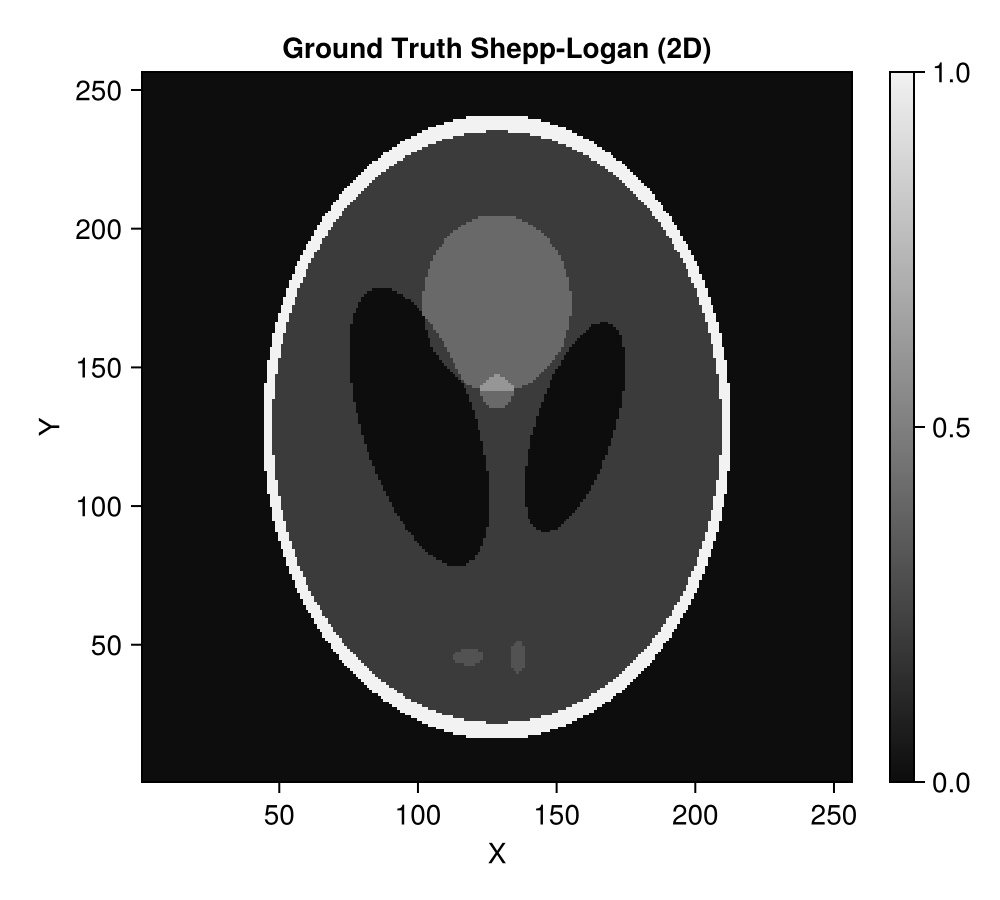
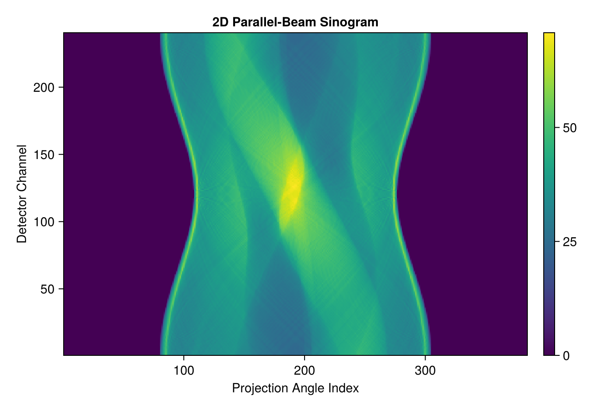
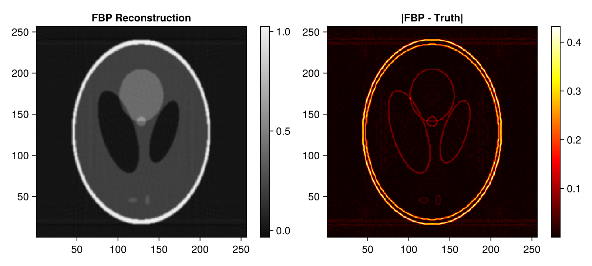
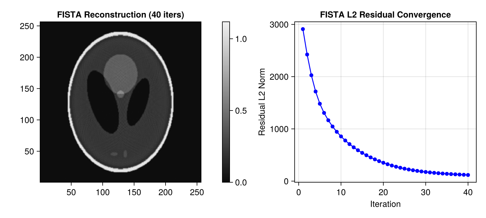
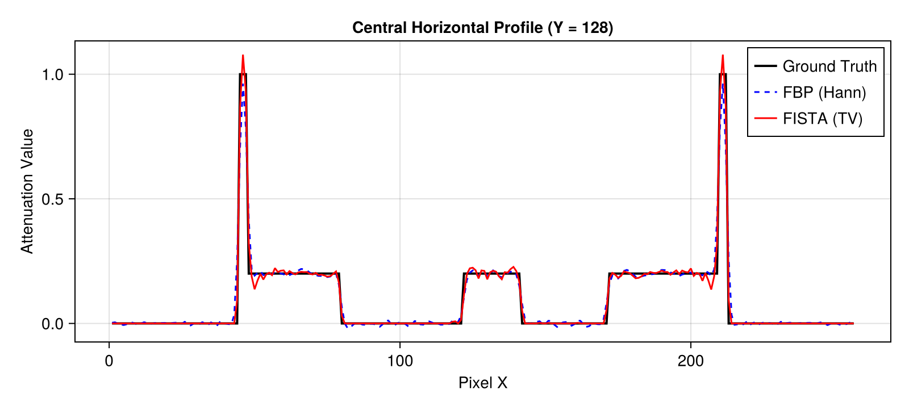

# 2D Parallel-Beam CT Demo with Tigre.jl

This tutorial demonstrates a complete 2D parallel-beam computed tomography (CT) workflow:
1. Generating a standard Shepp-Logan 2D phantom using **Tigre.jl**'s built-in `shepp_logan_3d`.
2. Configuring a 2D parallel-beam **Geometry** in **Tigre.jl**.
3. Simulating forward projection (Radon transform) using `Ax`.
4. Performing direct reconstruction using Filtered Backprojection (`fbp`).
5. Performing iterative reconstruction using Fast Iterative Shrinkage-Thresholding Algorithm (`fista`) with Total Variation (TV) regularization.
6. Comparing reconstruction accuracy and profile slices.

---
### Relevant Functions Used
- `Tigre.shepp_logan_3d`: Generates analytical Shepp-Logan ellipsoidal phantoms.
- `Tigre.Geometry`: Defines physical scanner parameters and acquisition trajectory.
- `Tigre.Ax`: Computes forward projection line integrals on GPU.
- `Tigre.fbp`: Direct Filtered Backprojection for parallel-beam geometry.
- `Tigre.fista`: Accelerated proximal gradient method with Total Variation (TV) denoising.

## Prerequisites
This tutorial uses **Makie** (recommended backend: **CairoMakie**) for visualization.
If `CairoMakie` is not installed in your environment, add it by running `using Pkg; Pkg.add("CairoMakie")`.

```julia
using LinearAlgebra
using CairoMakie
using Tigre
```

## 1. Synthetic Phantom Generation (Built-in `shepp_logan_3d`)

`Tigre.jl` includes a native analytical Shepp-Logan phantom generator (`shepp_logan_3d`).
To obtain a 2D slice, we generate a 3D phantom of size $N \times N \times N$ and extract an off-center axial slice ($Z = 3N/8$).
Since Tigre's internal CUDA operators work with 3D coordinate tensors `(nx, ny, nz)`, the 2D image is reshaped into `(N, N, 1)` with geometry voxel size `(N, N, 1)`.


```julia
N = 256
# Generate analytical 3D Shepp-Logan phantom and extract off-center axial slice ($Z = 3N/8$)
vol_3d_full = shepp_logan_3d(N; phantom_type = :yu_ye_wang)
phantom_2d = vol_3d_full[:, :, 3 * N ÷ 8]

# Reshape into (N, N, 1) for Tigre.jl
vol_phantom = reshape(phantom_2d, N, N, 1)

println("Phantom 2D size: ", size(phantom_2d))
println("Attenuation range: [", minimum(phantom_2d), ", ", maximum(phantom_2d), "]")

plotImg(phantom_2d; title = "Ground Truth Shepp-Logan (2D)", figure_size = (500, 450))

```

```text
Phantom 2D size: (256, 256)
Attenuation range: [-1.4901161e-8, 1.0]
```



## 2. Geometry Setup (2D Parallel-Beam)

In parallel-beam mode:
- `mode = :parallel`: Parallel x-ray beam geometry.
- `angles`: Array of rotation angles covering $[0, \pi]$ radians (180 degrees).
- `nVoxel = (N, N, 1)`: Volume grid with 1 slice in Z.
- `nDetector = (nDet, 1)`: Linear 1D detector with 1 row in V.
- `DSO` and `DSD`: Set equal (`1000f0`) to keep the scale factor neutral.


```julia
n_angles = 240
angles = Float32.(range(0, pi, length=n_angles))

n_det = 384 # Number of detector channels
geo = Geometry(
    mode = :parallel,
    angles = angles,
    nVoxel = (N, N, 1),
    sVoxel = (Float32(N), Float32(N), 1.0f0),
    nDetector = (n_det, 1),
    sDetector = (Float32(n_det), 1.0f0),
    DSO = 1000.0f0,
    DSD = 1000.0f0,
)

println("Geometry configured:")
println("  Volume size:     ", volume_size(geo))
println("  Projection size: ", projection_size(geo))

```

```text
Geometry configured:
  Volume size:     (256, 256, 1)
  Projection size: (384, 1, 240)
```

## 3. Forward Projection (`Ax`)

`Ax` calculates the line integrals through the volume along parallel rays. The resulting array has dimensions `(nDetector, 1, nAngles)`.


```julia
# Compute forward projection using native GPU Siddon ray-tracer
projections = Ax(vol_phantom, geo)

# Squeeze out the singleton detector V dimension to display the 2D sinogram (channels x angles)
sinogram = dropdims(projections, dims=2)

println("Sinogram dimensions (Channels x Angles): ", size(sinogram))

fig = Figure(size = (650, 450))
ax = Axis(fig[1, 1], title = "2D Parallel-Beam Sinogram", xlabel = "Projection Angle Index", ylabel = "Detector Channel")
hm = heatmap!(ax, sinogram, colormap = :viridis)
Colorbar(fig[1, 2], hm)
fig
```

```text
Sinogram dimensions (Channels x Angles): (384, 240)
```



## 4. Direct Reconstruction with FBP (`fbp`)

Filtered Backprojection (`fbp`) is the standard analytical direct inversion method for parallel-beam CT.
We apply a Hann windowed ramp filter (`filter = :hann`) to control high-frequency noise.


```julia
# Filtered Backprojection
rec_fbp_3d = fbp(projections, geo; filter = :hann)

# Drop singleton Z dimension to obtain (N, N) image
rec_fbp = dropdims(rec_fbp_3d, dims=3)

# Display reconstruction and difference image
fig = Figure(size = (800, 360))
ax1 = Axis(fig[1, 1], title = "FBP Reconstruction", aspect = DataAspect())
hm1 = heatmap!(ax1, rec_fbp, colormap = :grays)
Colorbar(fig[1, 2], hm1)

ax2 = Axis(fig[1, 3], title = "|FBP - Truth|", aspect = DataAspect())
hm2 = heatmap!(ax2, abs.(rec_fbp .- phantom_2d), colormap = :hot)
Colorbar(fig[1, 4], hm2)
fig
```



## 5. Iterative Reconstruction with FISTA (`fista`)

Fast Iterative Shrinkage-Thresholding Algorithm (`fista`) minimizes the least-squares data fidelity term with Total Variation (TV) regularization:
$$\min_x \frac{1}{2} \|Ax - b\|_2^2 + \lambda \operatorname{TV}(x) \quad \text{s.t.} \quad x \ge 0$$
- `tviter`: Number of inner gradient descent steps for TV denoising (default: 20).
- `tvlambda`: TV regularization strength.
- `nonneg = true`: Enforces physical non-negativity.
- `return_history = true`: Collects residual norm $\|Ax - b\|_2$ per iteration.


```julia
# =============================================================================
# Estimation of FISTA Lipschitz Hyperparameter (`hyper`)
#
# FISTA (Fast Iterative Shrinkage-Thresholding Algorithm) relies on proximal gradient descent.
# Its gradient step size is proportional to 1 / hyper, where hyper represents the Lipschitz
# constant L ≈ ||Aᵀ A||₂ (the spectral radius of the forward-backward projection operator).
#
# If `hyper` is left to the default fallback value, the gradient step size can be drastically
# mismatched (e.g. orders of magnitude too conservative), leading to poor reconstruction quality
# and near-zero convergence.
#
# We explicitly estimate `fista_hyper` beforehand using the SVD power method via `estimate_hyper(geo)`.
# Storing it in an explicit variable before calling `fista` makes the parameter calibration step
# transparent and easily verifiable, emphasizing the critical importance of proper operator norm scaling.
# =============================================================================
fista_hyper = estimate_hyper(geo)
println("Estimated FISTA Lipschitz hyperparameter: ", fista_hyper)

```

```text
Estimated FISTA Lipschitz hyperparameter: 124590.15
```

```julia
# Run 40 iterations of FISTA
niter = 40
rec_fista_3d, hist = fista(
    projections,
    geo,
    niter;
    hyper = fista_hyper,
    tviter = 10,
    tvlambda = 0.05f0,
    nonneg = true,
    return_history = true,
    compute_l2 = true,
)

rec_fista = dropdims(rec_fista_3d, dims=3)

fig = Figure(size = (800, 360))
ax1 = Axis(fig[1, 1], title = "FISTA Reconstruction ($niter iters)", aspect = DataAspect())
hm1 = heatmap!(ax1, rec_fista, colormap = :grays)
Colorbar(fig[1, 2], hm1)

ax2 = Axis(fig[1, 3], title = "FISTA L2 Residual Convergence", xlabel = "Iteration", ylabel = "Residual L2 Norm")
scatterlines!(ax2, 1:length(hist.residual_l2), hist.residual_l2, color = :blue)
fig
```



## 6. Comparison and Profile Analysis

We compare horizontal 1D profile slices through the center of the phantom ($Y = N/2$).


```julia
mid_y = N ÷ 2
fig = Figure(size = (800, 360))
ax = Axis(fig[1, 1], title = "Central Horizontal Profile (Y = $mid_y)", xlabel = "Pixel X", ylabel = "Attenuation Value")
lines!(ax, phantom_2d[:, mid_y], label = "Ground Truth", linewidth = 2, color = :black)
lines!(ax, rec_fbp[:, mid_y], label = "FBP (Hann)", linewidth = 1.5, linestyle = :dash, color = :blue)
lines!(ax, rec_fista[:, mid_y], label = "FISTA (TV)", linewidth = 1.5, color = :red)
axislegend(ax, position = :rt)
fig
```



## Summary
- **FBP**: Fast and accurate with full angular coverage; sensitive to noise and high-frequency filtering parameters.
- **FISTA**: Produces piecewise-smooth, noise-reduced reconstructions by incorporating Total Variation prior and non-negativity constraints.


