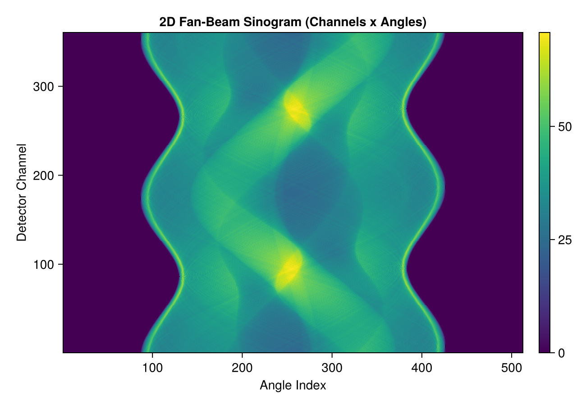
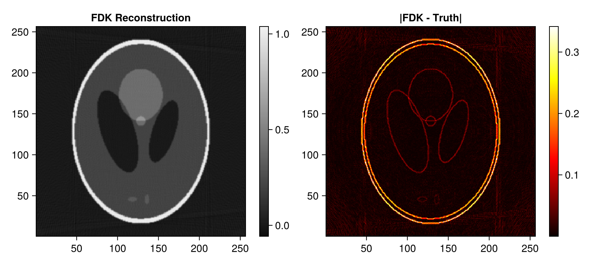
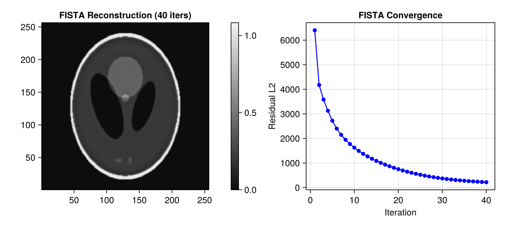
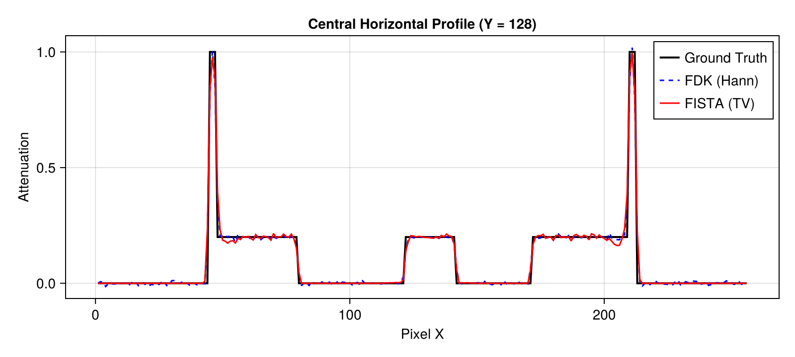

# 2D Cone-Beam (Fan-Beam) CT Demo with Tigre.jl

This tutorial demonstrates a 2D cone-beam (fan-beam) computed tomography workflow:
1. Generating a standard Shepp-Logan 2D phantom using **Tigre.jl**'s built-in `shepp_logan_3d`.
2. Configuring a diverging cone/fan-beam **Geometry** in **Tigre.jl** with finite source-to-object (`DSO`) and source-to-detector (`DSD`) distances.
3. Simulating forward projection with ray divergence via `Ax`.
4. Performing direct reconstruction using the Feldkamp-Davis-Kress (`fdk`) algorithm.
5. Performing iterative reconstruction using `fista` with Total Variation (TV) regularization.
6. Evaluating reconstruction fidelity and line profiles.

---
### Relevant Functions Used
- `Tigre.shepp_logan_3d`: Synthesizes standard analytical Shepp-Logan phantom.
- `Tigre.Geometry`: Configures cone-beam geometry with source-detector distances and magnification.
- `Tigre.Ax`: Simulates diverging ray-tracing projection on GPU.
- `Tigre.fdk`: Direct filtered backprojection with distance-dependent cone/fan-beam weighting.
- `Tigre.fista`: TV-regularized proximal gradient iterative solver.

## Prerequisites
This tutorial uses **Makie** (recommended backend: **CairoMakie**) for visualization.
If `CairoMakie` is not installed in your environment, add it by running `using Pkg; Pkg.add("CairoMakie")`.

```julia
using LinearAlgebra
using CairoMakie
using Tigre
```

## 1. Phantom Generation (Built-in `shepp_logan_3d`)

We extract an off-center axial slice ($Z = 3N/8$) containing fine high-contrast structures from a $256 \times 256 \times 256$ analytical Shepp-Logan volume and reshape it to `(256, 256, 1)`.


```julia
N = 256
vol_3d_full = shepp_logan_3d(N; phantom_type = :yu_ye_wang)
phantom_2d = vol_3d_full[:, :, 3 * N ÷ 8]
vol_phantom = reshape(phantom_2d, N, N, 1)

println("Phantom size: ", size(phantom_2d))

plotImg(phantom_2d; title = "Ground Truth Shepp-Logan (2D)", figure_size = (500, 450))

```

```text
Phantom size: (256, 256)
```


## 2. Geometry Setup (2D Cone/Fan-Beam)

For a diverging fan beam in the axial plane:
- `mode = :cone`: Cone/fan-beam projection mode.
- `angles`: 360 projections spanning a full circular orbit $[0, 2\pi]$ radians (360 degrees).
- `DSO = 1000f0` mm: Distance from x-ray source to object center of rotation.
- `DSD = 1500f0` mm: Distance from source to detector panel.
- Magnification factor: $M = \text{DSD} / \text{DSO} = 1500 / 1000 = 1.5$.


```julia
n_angles = 360
angles = Float32.(range(0, 2pi, length=n_angles))

n_det = 512 # Number of detector channels
geo = Geometry(
    mode = :cone,
    angles = angles,
    nVoxel = (N, N, 1),
    sVoxel = (Float32(N), Float32(N), 1.0f0),
    nDetector = (n_det, 1),
    sDetector = (Float32(n_det), 1.0f0),
    DSO = 1000.0f0,
    DSD = 1500.0f0,
)

println("Cone-beam geometry configured:")
println("  Magnification: ", geo.DSD[1] / geo.DSO[1])
println("  Volume size:   ", volume_size(geo))
println("  Detector size: ", projection_size(geo))

```

```text
Cone-beam geometry configured:
  Magnification: 1.5
  Volume size:   (256, 256, 1)
  Detector size: (512, 1, 360)
```

## 3. Forward Projection (`Ax`)

`Ax` simulates the divergent fan rays emanating from the focal spot through the volume onto the detector.


```julia
# Forward projection
projections = Ax(vol_phantom, geo)
sinogram = dropdims(projections, dims=2) # Drop singleton detector V dimension

println("Sinogram dimensions: ", size(sinogram))

fig = Figure(size = (650, 450))
ax = Axis(fig[1, 1], title = "2D Fan-Beam Sinogram (Channels x Angles)", xlabel = "Angle Index", ylabel = "Detector Channel")
hm = heatmap!(ax, sinogram, colormap = :viridis)
Colorbar(fig[1, 2], hm)
fig
```

```text
Sinogram dimensions: (512, 360)
```



## 4. Direct Reconstruction with FDK (`fdk`)

`fdk` applies:
1. Distance-weighting factors based on ray inclination.
2. 1D ramp filtration (here with a Hann window).
3. Cone-beam weighted backprojection into voxel space.


```julia
# FDK reconstruction
rec_fdk_3d = fdk(projections, geo; filter = :hann)
rec_fdk = dropdims(rec_fdk_3d, dims=3)

fig = Figure(size = (800, 360))
ax1 = Axis(fig[1, 1], title = "FDK Reconstruction", aspect = DataAspect())
hm1 = heatmap!(ax1, rec_fdk, colormap = :grays)
Colorbar(fig[1, 2], hm1)

ax2 = Axis(fig[1, 3], title = "|FDK - Truth|", aspect = DataAspect())
hm2 = heatmap!(ax2, abs.(rec_fdk .- phantom_2d), colormap = :hot)
Colorbar(fig[1, 4], hm2)
fig
```



## 5. Iterative Reconstruction with FISTA (`fista`)

FISTA uses the matched adjoint backprojector ($A^T$) to iteratively minimize data discrepancy while enforcing Total Variation sparsity and non-negativity.


```julia
# =============================================================================
# Estimation of FISTA Lipschitz Hyperparameter (`hyper`)
#
# FISTA (Fast Iterative Shrinkage-Thresholding Algorithm) relies on proximal gradient descent.
# Its gradient step size is proportional to 1 / hyper, where hyper represents the Lipschitz
# constant L ≈ ||Aᵀ A||₂ (the spectral radius of the forward-backward projection operator).
#
# If `hyper` is left to the default fallback value, the gradient step size can be drastically
# mismatched (e.g. orders of magnitude too conservative), leading to poor reconstruction quality
# and near-zero convergence.
#
# We explicitly estimate `fista_hyper` beforehand using the SVD power method via `estimate_hyper(geo)`.
# Storing it in an explicit variable before calling `fista` makes the parameter calibration step
# transparent and easily verifiable, emphasizing the critical importance of proper operator norm scaling.
# =============================================================================
fista_hyper = estimate_hyper(geo)
println("Estimated FISTA Lipschitz hyperparameter: ", fista_hyper)

```

```text
Estimated FISTA Lipschitz hyperparameter: 645486.7
```

```julia
# 40 iterations of FISTA
niter = 40
rec_fista_3d, hist = fista(
    projections,
    geo,
    niter;
    hyper = fista_hyper,
    tviter = 10,
    tvlambda = 0.05f0,
    nonneg = true,
    return_history = true,
    compute_l2 = true,
)

rec_fista = dropdims(rec_fista_3d, dims=3)

fig = Figure(size = (800, 360))
ax1 = Axis(fig[1, 1], title = "FISTA Reconstruction ($niter iters)", aspect = DataAspect())
hm1 = heatmap!(ax1, rec_fista, colormap = :grays)
Colorbar(fig[1, 2], hm1)

ax2 = Axis(fig[1, 3], title = "FISTA Convergence", xlabel = "Iteration", ylabel = "Residual L2")
scatterlines!(ax2, 1:length(hist.residual_l2), hist.residual_l2, color = :blue)
fig
```



## 6. Profile Comparison


```julia
mid_y = N ÷ 2
fig = Figure(size = (800, 360))
ax = Axis(fig[1, 1], title = "Central Horizontal Profile (Y = $mid_y)", xlabel = "Pixel X", ylabel = "Attenuation")
lines!(ax, phantom_2d[:, mid_y], label = "Ground Truth", linewidth = 2, color = :black)
lines!(ax, rec_fdk[:, mid_y], label = "FDK (Hann)", linewidth = 1.5, linestyle = :dash, color = :blue)
lines!(ax, rec_fista[:, mid_y], label = "FISTA (TV)", linewidth = 1.5, color = :red)
axislegend(ax, position = :rt)
fig
```



## Summary
- **FDK**: Standard for circular cone/fan beam trajectories; computationally fast.
- **FISTA**: Incorporates physical non-negativity and Total Variation regularization to eliminate high-frequency noise and reconstruct sharp internal interfaces.


