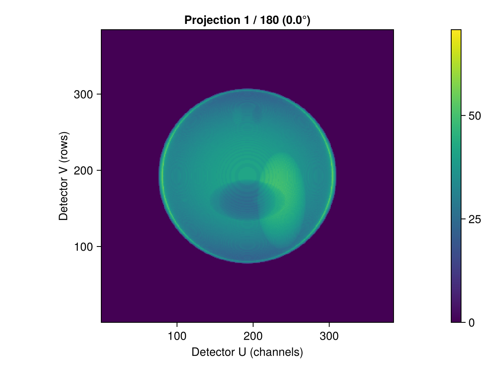
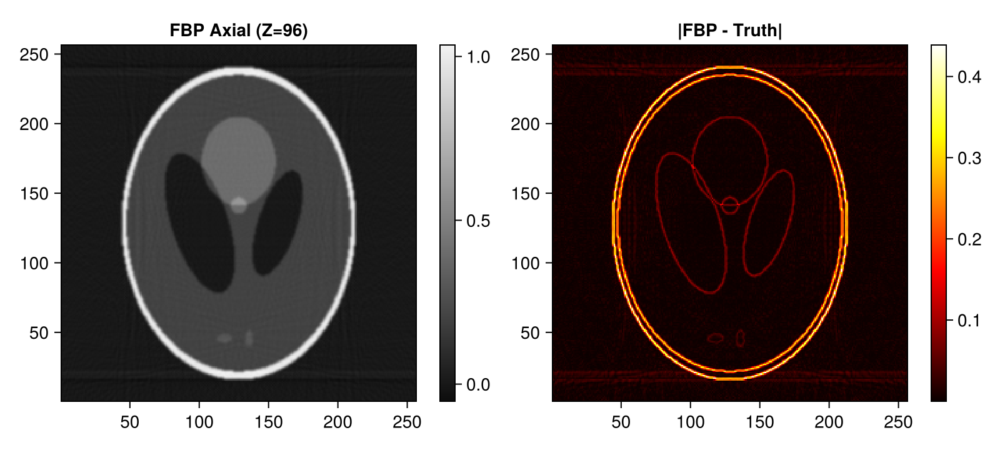
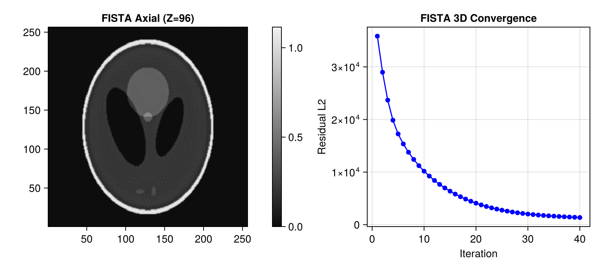
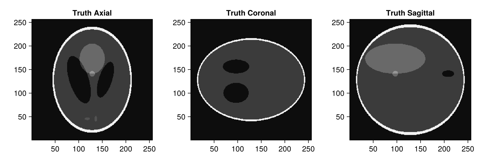
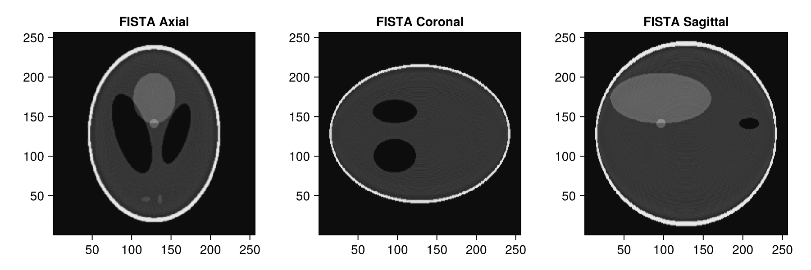

# 3D Parallel-Beam CT Demo with Tigre.jl

This tutorial demonstrates a complete 3D volumetric parallel-beam CT workflow (representative of synchrotron micro-CT beamlines):
1. Generating a 3D Shepp-Logan volume using **Tigre.jl**'s built-in `shepp_logan_3d`.
2. Configuring a 3D parallel-beam **Geometry** in **Tigre.jl**.
3. Simulating 3D forward projection onto a 2D planar detector using `Ax`.
4. Performing volumetric reconstruction using 3D Parallel Filtered Backprojection (`fbp`).
5. Performing 3D iterative reconstruction using `fista` with 3D Total Variation (TV) regularization.
6. Multi-planar visualization across axial, coronal, and sagittal orthogonal planes.

---
### Relevant Functions Used
- `Tigre.shepp_logan_3d`: Generates analytical 3D Shepp-Logan volumetric phantom.
- `Tigre.Geometry`: Sets up 3D parallel-beam acquisition geometry.
- `Tigre.Ax`: Computes 3D forward projection through voxel volume onto 2D detector array.
- `Tigre.fbp`: 3D parallel-beam filtered backprojection.
- `Tigre.fista`: Accelerated 3D proximal gradient reconstruction with 3D TV regularizer.

## Prerequisites
This tutorial uses **Makie** (recommended backend: **CairoMakie**) for visualization.
If `CairoMakie` is not installed in your environment, add it by running `using Pkg; Pkg.add("CairoMakie")`.

```julia
using LinearAlgebra
using CairoMakie
using Tigre
```

## 1. 3D Volumetric Phantom Generation (Built-in `shepp_logan_3d`)

We synthesize a $256 \times 256 \times 256$ volumetric Shepp-Logan phantom.


```julia
N = 256
vol_phantom = shepp_logan_3d(N; phantom_type = :yu_ye_wang)

println("3D Phantom dimensions: ", size(vol_phantom))
println("Value range: [", minimum(vol_phantom), ", ", maximum(vol_phantom), "]")

# Visualize axial slice (Z = 3N/8) using plotImg
mid_z = 3 * N ÷ 8
plotImg(vol_phantom; dim = :z, slice = mid_z, figure_size = (500, 450))

```

```text
3D Phantom dimensions: (256, 256, 256)
Value range: [-1.4901161e-8, 1.0]
```


## 2. 3D Parallel-Beam Geometry Setup

In 3D parallel-beam CT:
- Each detector row corresponds to an independent parallel slice projection.
- `angles`: 180 projection angles spanning $[0, \pi]$ radians (180 degrees).
- `nDetector = (nDetU, nDetV)`: 2D detector pixel grid.
- `DSO = DSD = 1000f0`: Distance values are identical for parallel-beam geometry.


```julia
n_angles = 180
angles = Float32.(range(0, pi, length=n_angles))

n_det = 384
geo = Geometry(
    mode = :parallel,
    angles = angles,
    nVoxel = (N, N, N),
    sVoxel = (Float32(N), Float32(N), Float32(N)),
    nDetector = (n_det, n_det),
    sDetector = (Float32(n_det), Float32(n_det)),
    DSO = 1000.0f0,
    DSD = 1000.0f0,
)

println("3D Parallel Geometry:")
println("  Volume size:     ", volume_size(geo))
println("  Projection size: ", projection_size(geo))

```

```text
3D Parallel Geometry:
  Volume size:     (256, 256, 256)
  Projection size: (384, 384, 180)
```

## 3. 3D Forward Projection (`Ax`)

`Ax` simulates projection through the 3D volume, producing an array of size `(nDetU, nDetV, nAngles)`.


```julia
projections = Ax(vol_phantom, geo)
println("Projections size (U x V x Angles): ", size(projections))

# Display projection radiograph at gantry angle 0° using plotProj
plotProj(projections, angles; slice = 1, figure_size = (600, 450))

```

```text
Projections size (U x V x Angles): (384, 384, 180)
```



## 4. Direct 3D Reconstruction with FBP (`fbp`)

`fbp` filters each detector slice with a ramp filter and backprojects across all projection angles.


```julia
rec_fbp = fbp(projections, geo; filter = :hann)

fig = Figure(size = (800, 360))
ax1 = Axis(fig[1, 1], title = "FBP Axial (Z=$mid_z)", aspect = DataAspect())
hm1 = heatmap!(ax1, rec_fbp[:, :, mid_z], colormap = :grays)
Colorbar(fig[1, 2], hm1)

ax2 = Axis(fig[1, 3], title = "|FBP - Truth|", aspect = DataAspect())
hm2 = heatmap!(ax2, abs.(rec_fbp[:, :, mid_z] .- vol_phantom[:, :, mid_z]), colormap = :hot)
Colorbar(fig[1, 4], hm2)
fig
```



## 5. Iterative 3D Reconstruction with FISTA (`fista`)

FISTA applies 3D Total Variation denoising (`tviter = 5`, `tvlambda = 0.05f0`) across all three spatial dimensions.


```julia
# =============================================================================
# Estimation of FISTA Lipschitz Hyperparameter (`hyper`)
#
# FISTA (Fast Iterative Shrinkage-Thresholding Algorithm) relies on proximal gradient descent.
# Its gradient step size is proportional to 1 / hyper, where hyper represents the Lipschitz
# constant L ≈ ||Aᵀ A||₂ (the spectral radius of the forward-backward projection operator).
#
# If `hyper` is left to the default fallback value, the gradient step size can be drastically
# mismatched (e.g. orders of magnitude too conservative), leading to poor reconstruction quality
# and near-zero convergence.
#
# We explicitly estimate `fista_hyper` beforehand using the SVD power method via `estimate_hyper(geo)`.
# Storing it in an explicit variable before calling `fista` makes the parameter calibration step
# transparent and easily verifiable, emphasizing the critical importance of proper operator norm scaling.
# =============================================================================
fista_hyper = estimate_hyper(geo)
println("Estimated FISTA Lipschitz hyperparameter: ", fista_hyper)

```

```text
Estimated FISTA Lipschitz hyperparameter: 93445.61
```

```julia
niter = 40
rec_fista, hist = fista(
    projections,
    geo,
    niter;
    hyper = fista_hyper,
    tviter = 5,
    tvlambda = 0.05f0,
    nonneg = true,
    return_history = true,
    compute_l2 = true,
)

fig = Figure(size = (800, 360))
ax1 = Axis(fig[1, 1], title = "FISTA Axial (Z=$mid_z)", aspect = DataAspect())
hm1 = heatmap!(ax1, rec_fista[:, :, mid_z], colormap = :grays)
Colorbar(fig[1, 2], hm1)

ax2 = Axis(fig[1, 3], title = "FISTA 3D Convergence", xlabel = "Iteration", ylabel = "Residual L2")
scatterlines!(ax2, 1:length(hist.residual_l2), hist.residual_l2, color = :blue)
fig
```



## 6. Multi-Planar Orthogonal Views

We inspect the 3D volume along the three canonical orthogonal cross-sections:
- **Axial** ($XY$ plane)
- **Coronal** ($XZ$ plane)
- **Sagittal** ($YZ$ plane)


```julia
mid_x = N ÷ 2
mid_y = N ÷ 2

# Ground truth views
fig = Figure(size = (900, 300))
ax1 = Axis(fig[1, 1], title = "Truth Axial", aspect = DataAspect())
heatmap!(ax1, vol_phantom[:, :, mid_z], colormap = :grays)

ax2 = Axis(fig[1, 2], title = "Truth Coronal", aspect = DataAspect())
heatmap!(ax2, vol_phantom[:, mid_y, :]', colormap = :grays)

ax3 = Axis(fig[1, 3], title = "Truth Sagittal", aspect = DataAspect())
heatmap!(ax3, vol_phantom[mid_x, :, :]', colormap = :grays)
fig
```



```julia
# FISTA reconstructed views
fig = Figure(size = (900, 300))
ax1 = Axis(fig[1, 1], title = "FISTA Axial", aspect = DataAspect())
heatmap!(ax1, rec_fista[:, :, mid_z], colormap = :grays)

ax2 = Axis(fig[1, 2], title = "FISTA Coronal", aspect = DataAspect())
heatmap!(ax2, rec_fista[:, mid_y, :]', colormap = :grays)

ax3 = Axis(fig[1, 3], title = "FISTA Sagittal", aspect = DataAspect())
heatmap!(ax3, rec_fista[mid_x, :, :]', colormap = :grays)
fig
```



## Summary
- In 3D parallel-beam geometry, `Tigre.jl` provides fast volumetric projection and backprojection.
- FISTA with 3D TV regularization enforces spatial consistency across adjacent slices, effectively suppressing noise and ringing.


