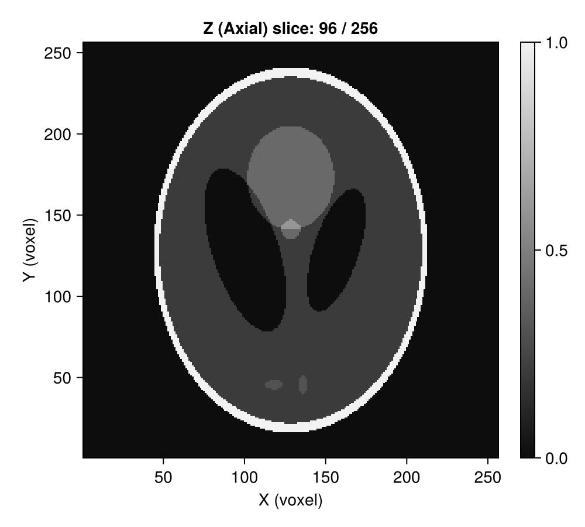
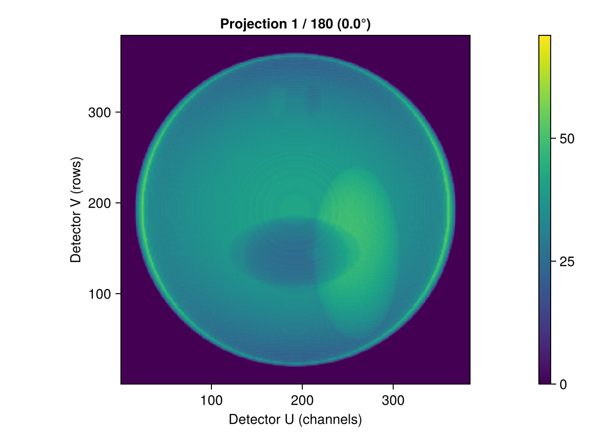
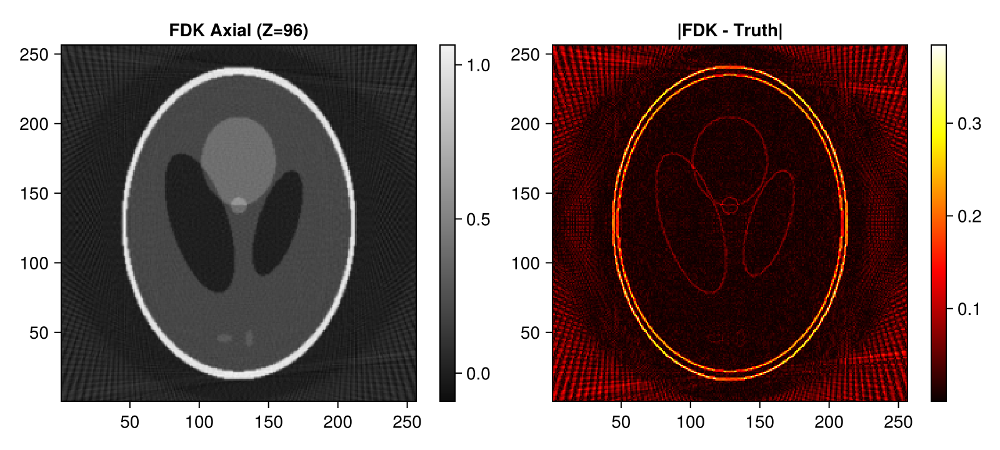
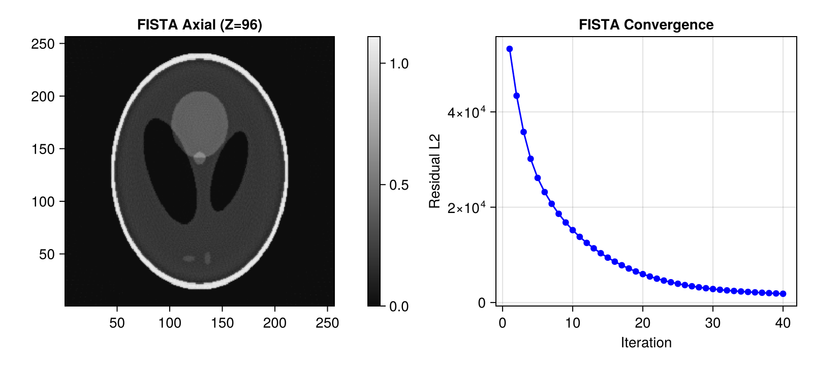
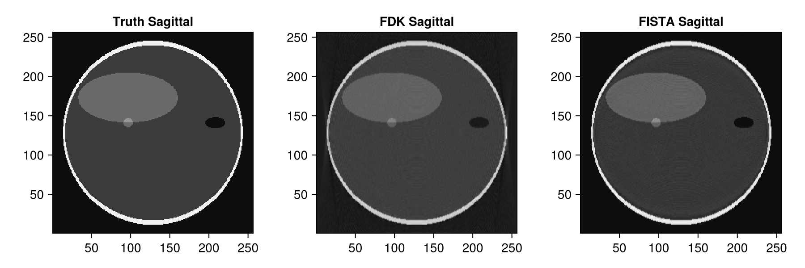
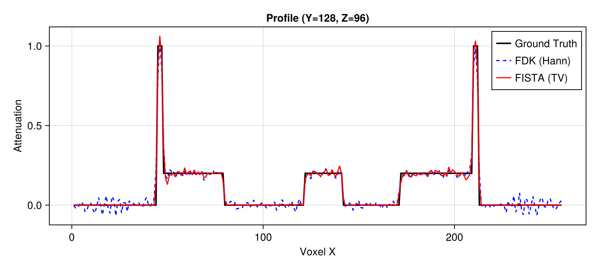

# 3D Cone-Beam CT (CBCT) Demo with Tigre.jl

This tutorial demonstrates 3D Cone-Beam Computed Tomography (CBCT):
1. Generating an analytical 3D Shepp-Logan volume using **Tigre.jl**'s built-in `shepp_logan_3d`.
2. Setting up a 3D cone-beam **Geometry** in **Tigre.jl** with source-to-object (`DSO`) and source-to-detector (`DSD`) distances.
3. Simulating 3D cone-beam forward projection onto a flat-panel detector using `Ax`.
4. Volumetric reconstruction using the Feldkamp-Davis-Kress (`fdk`) algorithm.
5. Volumetric iterative reconstruction using `fista` with 3D Total Variation regularization.
6. Multi-planar orthogonal slice inspection and profile analysis.

---
### Relevant Functions Used
- `Tigre.shepp_logan_3d`: Generates analytical 3D Shepp-Logan test phantom.
- `Tigre.Geometry`: Sets up cone-beam CT scanner configuration and circular trajectory.
- `Tigre.Ax`: Simulates 3D ray-tracing with true 3D cone divergence.
- `Tigre.fdk`: 3D Feldkamp-Davis-Kress filtered backprojection.
- `Tigre.fista`: Accelerated 3D iterative proximal gradient solver with TV denoising.

## Prerequisites
This tutorial uses **Makie** (recommended backend: **CairoMakie**) for visualization.
If `CairoMakie` is not installed in your environment, add it by running `using Pkg; Pkg.add("CairoMakie")`.

```julia
using LinearAlgebra
using CairoMakie
using Tigre
```

## 1. 3D Phantom Generation (Built-in `shepp_logan_3d`)

We generate a $256 \times 256 \times 256$ volumetric Shepp-Logan phantom.


```julia
N = 256
vol_phantom = shepp_logan_3d(N; phantom_type = :yu_ye_wang)

println("3D Phantom size: ", size(vol_phantom))
mid_z = 3 * N ÷ 8

plotImg(vol_phantom; dim = :z, slice = mid_z, figure_size = (500, 450))

```

```text
3D Phantom size: (256, 256, 256)
```



## 2. 3D Cone-Beam Geometry Setup

In cone-beam geometry:
- X-rays diverge in both horizontal ($U$) and vertical ($V$) directions.
- `DSO = 1000f0` mm and `DSD = 1500f0` mm (Magnification $M = 1.5$).
- Trajectory: Circular orbit covering $360^\circ$ ($[0, 2\pi]$).
- Flat-panel detector: $384 \times 384$ pixels.


```julia
n_angles = 180
angles = Float32.(range(0, 2pi, length=n_angles))

n_det = 384
geo = Geometry(
    mode = :cone,
    angles = angles,
    nVoxel = (N, N, N),
    sVoxel = (Float32(N), Float32(N), Float32(N)),
    nDetector = (n_det, n_det),
    sDetector = (Float32(n_det), Float32(n_det)),
    DSO = 1000.0f0,
    DSD = 1500.0f0,
)

println("3D Cone-Beam Geometry:")
println("  Magnification:   ", geo.DSD[1] / geo.DSO[1])
println("  Volume size:     ", volume_size(geo))
println("  Projection size: ", projection_size(geo))

```

```text
3D Cone-Beam Geometry:
  Magnification:   1.5
  Volume size:     (256, 256, 256)
  Projection size: (384, 384, 180)
```

## 3. 3D Forward Projection (`Ax`)

`Ax` performs GPU-accelerated cone-beam ray-tracing through the volume, recording 2D planar projection radiographs at each gantry angle.


```julia
projections = Ax(vol_phantom, geo)
println("Projections size: ", size(projections))

# Display projection radiograph at gantry angle 0° using plotProj
plotProj(projections, angles; slice = 1, figure_size = (600, 450))

```

```text
Projections size: (384, 384, 180)
```



## 4. 3D FDK Reconstruction (`fdk`)

The standard analytical solution for circular cone-beam CT is the FDK algorithm, which applies:
1. Distance weighting $w(u, v) = \frac{\text{DSD}}{\sqrt{\text{DSD}^2 + u^2 + v^2}}$.
2. Ramp filtration along horizontal detector rows.
3. 3D cone backprojection with $1/r^2$ depth weighting.


```julia
rec_fdk = fdk(projections, geo; filter = :hann)

fig = Figure(size = (800, 360))
ax1 = Axis(fig[1, 1], title = "FDK Axial (Z=$mid_z)", aspect = DataAspect())
hm1 = heatmap!(ax1, rec_fdk[:, :, mid_z], colormap = :grays)
Colorbar(fig[1, 2], hm1)

ax2 = Axis(fig[1, 3], title = "|FDK - Truth|", aspect = DataAspect())
hm2 = heatmap!(ax2, abs.(rec_fdk[:, :, mid_z] .- vol_phantom[:, :, mid_z]), colormap = :hot)
Colorbar(fig[1, 4], hm2)
fig
```



## 5. Iterative 3D Reconstruction with FISTA (`fista`)

FISTA iteratively reconstructs the full 3D volume while applying 3D Total Variation denoising to suppress noise and mitigate cone-beam sampling artifacts.


```julia
# =============================================================================
# Estimation of FISTA Lipschitz Hyperparameter (`hyper`)
#
# FISTA (Fast Iterative Shrinkage-Thresholding Algorithm) relies on proximal gradient descent.
# Its gradient step size is proportional to 1 / hyper, where hyper represents the Lipschitz
# constant L ≈ ||Aᵀ A||₂ (the spectral radius of the forward-backward projection operator).
#
# If `hyper` is left to the default fallback value, the gradient step size can be drastically
# mismatched (e.g. orders of magnitude too conservative), leading to poor reconstruction quality
# and near-zero convergence.
#
# We explicitly estimate `fista_hyper` beforehand using the SVD power method via `estimate_hyper(geo)`.
# Storing it in an explicit variable before calling `fista` makes the parameter calibration step
# transparent and easily verifiable, emphasizing the critical importance of proper operator norm scaling.
# =============================================================================
fista_hyper = estimate_hyper(geo)
println("Estimated FISTA Lipschitz hyperparameter: ", fista_hyper)

```

```text
Estimated FISTA Lipschitz hyperparameter: 211194.28
```

```julia
niter = 40
rec_fista, hist = fista(
    projections,
    geo,
    niter;
    hyper = fista_hyper,
    tviter = 5,
    tvlambda = 0.05f0,
    nonneg = true,
    return_history = true,
    compute_l2 = true,
)

fig = Figure(size = (800, 360))
ax1 = Axis(fig[1, 1], title = "FISTA Axial (Z=$mid_z)", aspect = DataAspect())
hm1 = heatmap!(ax1, rec_fista[:, :, mid_z], colormap = :grays)
Colorbar(fig[1, 2], hm1)

ax2 = Axis(fig[1, 3], title = "FISTA Convergence", xlabel = "Iteration", ylabel = "Residual L2")
scatterlines!(ax2, 1:length(hist.residual_l2), hist.residual_l2, color = :blue)
fig
```



## 6. Multi-Planar Orthogonal Comparison

We compare the reconstructed volume across the three primary anatomic views.


```julia
mid_x = N ÷ 2
mid_y = N ÷ 2

# Compare sagittal planes (YZ)
fig = Figure(size = (900, 300))
ax1 = Axis(fig[1, 1], title = "Truth Sagittal", aspect = DataAspect())
heatmap!(ax1, vol_phantom[mid_x, :, :]', colormap = :grays)

ax2 = Axis(fig[1, 2], title = "FDK Sagittal", aspect = DataAspect())
heatmap!(ax2, rec_fdk[mid_x, :, :]', colormap = :grays)

ax3 = Axis(fig[1, 3], title = "FISTA Sagittal", aspect = DataAspect())
heatmap!(ax3, rec_fista[mid_x, :, :]', colormap = :grays)
fig
```



```julia
# Horizontal profile through axial slice ($Z = 3N/8$)
fig = Figure(size = (800, 360))
ax = Axis(fig[1, 1], title = "Profile (Y=$mid_y, Z=$mid_z)", xlabel = "Voxel X", ylabel = "Attenuation")
lines!(ax, vol_phantom[:, mid_y, mid_z], label = "Ground Truth", linewidth = 2, color = :black)
lines!(ax, rec_fdk[:, mid_y, mid_z], label = "FDK (Hann)", linewidth = 1.5, linestyle = :dash, color = :blue)
lines!(ax, rec_fista[:, mid_y, mid_z], label = "FISTA (TV)", linewidth = 1.5, color = :red)
axislegend(ax, position = :rt)
fig
```



## Summary
- **FDK**: Analytical method yielding instantaneous results for full-dose/full-view acquisitions.
- **FISTA (3D TV)**: Iterative optimization effectively eliminates cone-beam streak artifacts and noise while accurately preserving sharp multi-planar edges.


