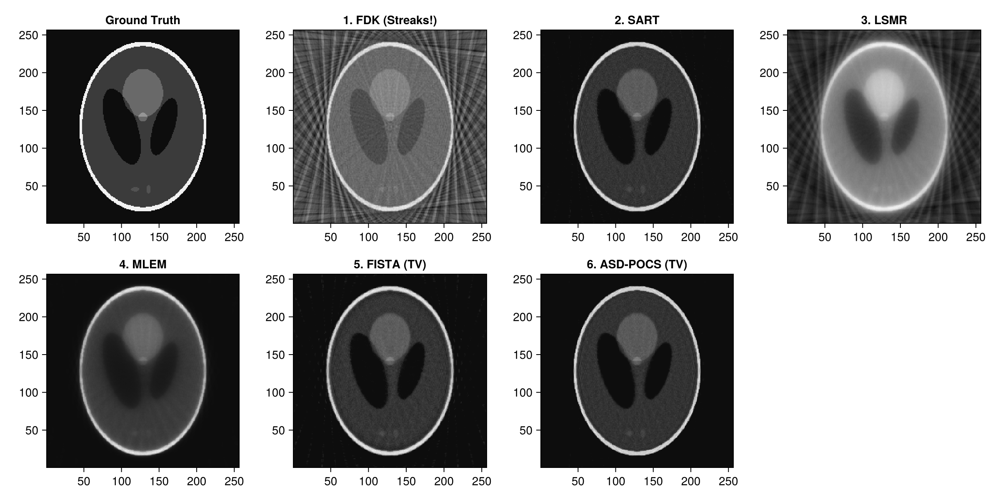
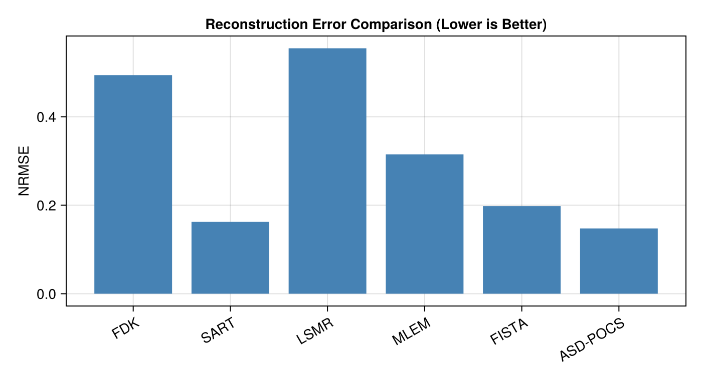

# Comparison of Iterative CT Reconstruction Algorithms (Sparse-View CT)

In low-dose and rapid CT scanning, the number of acquired projection angles is often severely constrained (e.g. only 30 angles). Under these conditions:
- **Direct methods (FDK)** produce severe streak artifacts due to angular under-sampling.
- **Unregularized iterative methods (SART, LSMR)** reduce streaks but amplify high-frequency noise.
- **Statistical methods (MLEM)** model Poisson photon statistics.
- **Total Variation regularized methods (FISTA, ASD-POCS)** leverage compressed sensing principles to reconstruct clean, sharp images from sparse projections.

This notebook evaluates and compares 6 distinct solvers on identical sparse-view data:
1. `fdk` (Analytical baseline)
2. `sart` (Algebraic reconstruction)
3. `lsmr` (Krylov subspace least squares)
4. `mlem` (Maximum Likelihood Expectation Maximization)
5. `fista` (Total Variation proximal gradient)
6. `asd_pocs` (Adaptive Steepest Descent POCS)

---
### Relevant Functions Used
- `Tigre.shepp_logan_3d`: Generates analytical ground truth phantom.
- `Tigre.fdk`, `Tigre.sart`, `Tigre.lsmr`, `Tigre.mlem`, `Tigre.fista`, `Tigre.asd_pocs`.

## Prerequisites
This tutorial uses **Makie** (recommended backend: **CairoMakie**) for visualization.
If `CairoMakie` is not installed in your environment, add it by running `using Pkg; Pkg.add("CairoMakie")`.

```julia
using LinearAlgebra
using CairoMakie
using Tigre
```

## 1. Phantom and Sparse-View Geometry Setup

We simulate a sparse-view acquisition with only **45 projection angles** over $360^\circ$.


```julia
N = 256
vol_3d_full = shepp_logan_3d(N; phantom_type = :yu_ye_wang)
phantom_2d = vol_3d_full[:, :, 3 * N ÷ 8]
vol_phantom = reshape(phantom_2d, N, N, 1)

# Only 45 projection angles!
n_sparse_angles = 45
angles = Float32.(range(0, 2pi, length=n_sparse_angles))

n_det = 384
geo = Geometry(
    mode = :cone,
    angles = angles,
    nVoxel = (N, N, 1),
    sVoxel = (Float32(N), Float32(N), 1.0f0),
    nDetector = (n_det, 1),
    sDetector = (Float32(n_det), 1.0f0),
    DSO = 1000.0f0,
    DSD = 1500.0f0,
)

println("Simulating sparse-view CT with $(n_sparse_angles) angles")
projections = Ax(vol_phantom, geo);
```

```text
Simulating sparse-view CT with 45 angles
```

## 2. Running the 6 Solvers


```julia
# =============================================================================
# Estimation of FISTA Lipschitz Hyperparameter (`hyper`)
#
# FISTA (Fast Iterative Shrinkage-Thresholding Algorithm) relies on proximal gradient descent.
# Its gradient step size is proportional to 1 / hyper, where hyper represents the Lipschitz
# constant L ≈ ||Aᵀ A||₂ (the spectral radius of the forward-backward projection operator).
#
# If `hyper` is left to the default fallback value, the gradient step size can be drastically
# mismatched (e.g. orders of magnitude too conservative), leading to poor reconstruction quality
# and near-zero convergence.
#
# We explicitly estimate `fista_hyper` beforehand using the SVD power method via `estimate_hyper(geo)`.
# Storing it in an explicit variable before calling `fista` makes the parameter calibration step
# transparent and easily verifiable, emphasizing the critical importance of proper operator norm scaling.
# =============================================================================
fista_hyper = estimate_hyper(geo)
println("Estimated FISTA Lipschitz hyperparameter: ", fista_hyper)

```

```text
Estimated FISTA Lipschitz hyperparameter: 79802.766
```

```julia
println("1. Running FDK...")
rec_fdk = dropdims(fdk(projections, geo; filter = :hann), dims=3)

println("2. Running SART (10 iterations)...")
rec_sart = dropdims(sart(projections, geo, 10; lambda = 1.0f0), dims=3)

println("3. Running LSMR (15 iterations)...")
rec_lsmr = dropdims(lsmr(projections, geo, 15), dims=3)

println("4. Running MLEM (15 iterations)...")
rec_mlem = dropdims(mlem(projections, geo, 15), dims=3)

println("5. Running FISTA with TV (40 iterations)...")
rec_fista = dropdims(fista(projections, geo, 40; hyper = fista_hyper, tviter = 10, tvlambda = 0.05f0), dims=3)

println("6. Running ASD-POCS with TV (15 iterations)...")
rec_asdpocs = dropdims(asd_pocs(projections, geo, 15; tviter = 15, alpha = 0.002f0), dims=3)

println("All reconstructions completed successfully!")

```

```text
1. Running FDK...
2. Running SART (10 iterations)...
3. Running LSMR (15 iterations)...
4. Running MLEM (15 iterations)...
5. Running FISTA with TV (40 iterations)...
6. Running ASD-POCS with TV (15 iterations)...
All reconstructions completed successfully!
```

## 3. Visual Comparison Matrix


```julia
# Plot all reconstructions side-by-side
titles = [
    "Ground Truth", "1. FDK (Streaks!)", "2. SART", "3. LSMR",
    "4. MLEM", "5. FISTA (TV)", "6. ASD-POCS (TV)"
]
imgs = [phantom_2d, rec_fdk, rec_sart, rec_lsmr, rec_mlem, rec_fista, rec_asdpocs]

fig = Figure(size = (1200, 600))
for (idx, (t, img)) in enumerate(zip(titles, imgs))
    row = (idx - 1) ÷ 4 + 1
    col = (idx - 1) % 4 + 1
    ax = Axis(fig[row, col], title = t, aspect = DataAspect())
    heatmap!(ax, img, colormap = :grays)
end
fig
```



## 4. Quantitative Metrics: Normalized RMSE

We calculate the Normalized Root Mean Squared Error (NRMSE) against the ground truth phantom:
$$\text{NRMSE}(x, x^*) = \frac{\|x - x^*\|_2}{\|x^*\|_2}$$


```julia
function nrmse(x, x_true)
    return norm(vec(x) .- vec(x_true)) / norm(vec(x_true))
end

metrics = [
    ("FDK", nrmse(rec_fdk, phantom_2d)),
    ("SART", nrmse(rec_sart, phantom_2d)),
    ("LSMR", nrmse(rec_lsmr, phantom_2d)),
    ("MLEM", nrmse(rec_mlem, phantom_2d)),
    ("FISTA", nrmse(rec_fista, phantom_2d)),
    ("ASD-POCS", nrmse(rec_asdpocs, phantom_2d)),
]

println("--- Quantitative Accuracy (Normalized RMSE) ---")
for (name, val) in metrics
    println(rpad(name, 12), ": ", round(val, digits=4))
end

names = [m[1] for m in metrics]
vals = [Float32(m[2]) for m in metrics]

fig = Figure(size = (700, 380))
ax = Axis(fig[1, 1], title = "Reconstruction Error Comparison (Lower is Better)",
          ylabel = "NRMSE", xticks = (1:length(names), names),
          xticklabelrotation = Float32(pi/6))
barplot!(ax, 1:length(names), vals, color = :steelblue)
fig

```

```text
--- Quantitative Accuracy (Normalized RMSE) ---
FDK         : 0.494
SART        : 0.1624
LSMR        : 0.5547
MLEM        : 0.315
FISTA       : 0.1981
ASD-POCS    : 0.1475
```



## Summary
- **FDK**: Suffers from heavy view-aliasing streaks when projection count is low ($N_\theta = 30$).
- **SART & LSMR**: Improve data fidelity and reduce global streaks, but residual noise remains.
- **FISTA & ASD-POCS**: Total Variation regularizers suppress streak artifacts while recovering clean flat regions and sharp structural edges.


