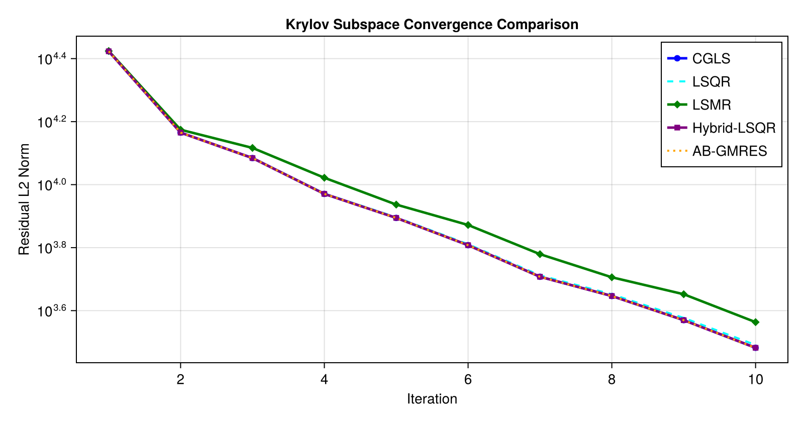
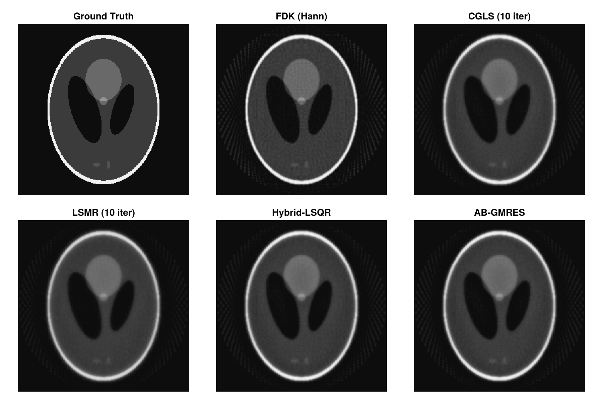
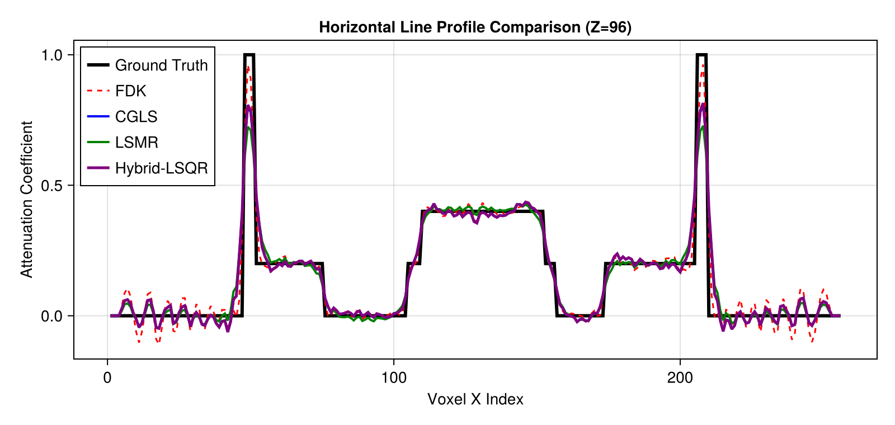

# Krylov Subspace Solvers in Tigre.jl: CGLS, LSQR, LSMR, & Hybrid Methods

Tomographic iterative reconstruction poses large-scale linear least-squares problems of the form:
$$\min_x \frac{1}{2} \| A x - b \|_2^2$$
where $A$ is the cone-beam projection operator (`Ax`), $A^T$ is the backprojection operator (`Atb`), and $b$ is the measured sinogram.

Because $A$ cannot be explicitly formed or stored in memory for 3D volumes (which often contain millions to billions of voxels), **matrix-free Krylov subspace methods** are the gold standard for fast, high-accuracy CT reconstruction. These methods iteratively construct optimal polynomial approximations in the Krylov subspace $\mathcal{K}_k(A^T A, A^T b)$ using only forward and adjoint projection calls.

### Solvers Benchmarked in this Tutorial
1. **CGLS (Conjugate Gradient for Least Squares)**: Solves the normal equations $A^T A x = A^T b$ directly using conjugate gradients with implicit $A^T A$ operations.
2. **LSQR (Golub-Kahan Bidiagonalization)**: Analytically equivalent to CGLS in exact arithmetic, but provides superior numerical stability in ill-conditioned and rank-deficient regimes.
3. **LSMR (Minimal Residual on Normal Equations)**: Solves $\min_x \| A^T (A x - b) \|_2$, guaranteeing monotonically non-increasing normal equation residuals.
4. **Hybrid-LSQR (Subspace Regularization)**: Projects the problem into a Krylov subspace of dimension $k$ and solves a projected Tikhonov regularized problem at each step.
5. **AB-GMRES / BA-GMRES**: Generalized Minimal Residual formulations adapted for unsymmetric and rectangular tomographic operators.

---
### Key Tigre.jl Features Demonstrated
- **`prepare_krylov_workspace`**: One-time preallocation of projection and volume buffers for zero-allocation high-throughput iterative loops.
- **In-place computation (`cgls!`, `lsqr!`, `lsmr!`)**: Direct volume updates eliminating intermediate garbage collection overhead.
- **`return_history = true`**: Built-in convergence tracking (`IterativeHistory`) logging residual norms and early stopping criteria.
- **`measure_quality` & `crop_cbct!`**: Quantitative evaluation (PSNR, SSIM, RMSE, NCC) within cylindrical FOV.

## Prerequisites
This tutorial uses **Makie** (recommended backend: **CairoMakie**) for visualization.
If `CairoMakie` is not installed in your environment, add it by running `using Pkg; Pkg.add("CairoMakie")`.

```julia
using LinearAlgebra
using Printf
using Random
using CairoMakie
using Tigre
```

## 1. Geometry Setup & Ground Truth Phantom

We set up a realistic 3D Cone-Beam geometry with 100 projection angles covering a full $360^\circ$ rotation, simulating an industrial micro-CT or clinical CBCT scanner.
We then generate a 3D Shepp-Logan phantom and compute forward projections `b = Ax(x)` with realistic CT noise (Poisson photon quantum noise and Gaussian electronic readout noise).


```julia
nangles = 100
angles = LinRange(0f0, 2f0 * Float32(pi), nangles + 1)[1:end-1] |> collect

geo = Geometry(
    mode = :cone,
    angles = angles,
    nVoxel = (256, 256, 256),
    sVoxel = (256f0, 256f0, 256f0),
    nDetector = (320, 320),
    sDetector = (480f0, 480f0),
    DSO = 1000f0,
    DSD = 1500f0
)

# Generate Shepp-Logan 3D volume
phantom = shepp_logan_3d(geo.nVoxel)

# Clean forward projection
proj_clean = Ax(phantom, geo)

# Add realistic CT noise (I0 = 100,000 incident photons per detector pixel)
proj_noisy = add_ct_noise(proj_clean; I0 = 100000.0, gaussian = (0f0, 0.5f0), rng = MersenneTwister(42))

# Analytical FDK baseline for comparison
rec_fdk = crop_cbct!(fdk(proj_noisy, geo; filter = :hann), geo)

println("Geometry & data generated:")
println("  Volume size:     ", volume_size(geo))
println("  Projection size: ", projection_size(geo))
println("  Projections:     ", length(angles), " views")

```

```text
Geometry & data generated:
  Volume size:     (256, 256, 256)
  Projection size: (320, 320, 100)
  Projections:     100 views
```

## 2. Zero-Allocation High-Throughput: `prepare_krylov_workspace`

Each iteration of a Krylov solver requires evaluating matrix-vector products $A p$ and $A^T r$, maintaining direction vectors, and storing intermediate volume/projection buffers.

In high-performance production pipelines (e.g. 4D dynamic CT or batch manufacturing inspection), repeatedly allocating these 3D arrays introduces substantial memory churn and garbage collection pauses.

**Tigre.jl** provides `prepare_krylov_workspace(geo; maxiter)`:
- Preallocates all necessary volume and projection temporary arrays.
- Preallocates the Krylov subspace basis matrices when running subspace-expanded solvers like `hybrid_lsqr`.
- Can be reused across multiple reconstruction runs, time steps, or algorithm comparisons.


```julia
# Preallocate Krylov workspace for up to 15 iterations
max_iter = 10
ws = prepare_krylov_workspace(geo; maxiter = max_iter)

println("KrylovWorkspace allocated:")
println("  Projection buffer shape: ", size(ws.proj_a))
println("  Volume buffer shape:     ", size(ws.vol_a))
println("  Subspace basis size:     ", ws.subspace !== nothing ? size(ws.subspace.vol_basis) : "none")

```

```text
KrylovWorkspace allocated:
  Projection buffer shape: (320, 320, 100)
  Volume buffer shape:     (256, 256, 256)
  Subspace basis size:     (11, 16777216)
```

## 3. Benchmarking Krylov Solvers with History Tracking

We now benchmark 5 Krylov subspace algorithms using the preallocated workspace `ws` and logging full convergence histories via `return_history = true`:
1. **CGLS**: Standard Conjugate Gradient for Least Squares
2. **LSQR**: Golub-Kahan bidiagonalization with superior conditioning
3. **LSMR**: Minimal residual on normal equations with monotonic residual decrease
4. **Hybrid-LSQR**: Projected Tikhonov regularization in the Krylov subspace ($\lambda = 0.5$)
5. **AB-GMRES**: Range-space Generalized Minimal Residual solver


```julia
niter = 10

println("--> Running CGLS...")
t_cgls = @timed cgls(proj_noisy, geo, niter; return_history = true, workspace = ws)
rec_cgls, hist_cgls = t_cgls.value
crop_cbct!(rec_cgls, geo)

println("--> Running LSQR...")
t_lsqr = @timed lsqr(proj_noisy, geo, niter; return_history = true, workspace = ws)
rec_lsqr, hist_lsqr = t_lsqr.value
crop_cbct!(rec_lsqr, geo)

println("--> Running LSMR...")
t_lsmr = @timed lsmr(proj_noisy, geo, niter; return_history = true, workspace = ws)
rec_lsmr, hist_lsmr = t_lsmr.value
crop_cbct!(rec_lsmr, geo)

println("--> Running Hybrid-LSQR (lambda = 0.5)...")
t_hybrid = @timed hybrid_lsqr(proj_noisy, geo, niter; lambda = 0.5f0, return_history = true, workspace = ws)
rec_hybrid, hist_hybrid = t_hybrid.value
crop_cbct!(rec_hybrid, geo)

println("--> Running AB-GMRES...")
t_ab = @timed ab_gmres(proj_noisy, geo, niter; return_history = true, workspace = ws)
rec_ab, hist_ab = t_ab.value
crop_cbct!(rec_ab, geo)

@printf("All solvers completed:\n")
@printf("  CGLS:        %.3f s, final residual = %.2f\n", t_cgls.time, hist_cgls.residual_l2[end])
@printf("  LSQR:        %.3f s, final residual = %.2f\n", t_lsqr.time, hist_lsqr.residual_l2[end])
@printf("  LSMR:        %.3f s, final residual = %.2f\n", t_lsmr.time, hist_lsmr.residual_l2[end])
@printf("  Hybrid-LSQR: %.3f s, final residual = %.2f\n", t_hybrid.time, hist_hybrid.residual_l2[end])
@printf("  AB-GMRES:    %.3f s, final residual = %.2f\n", t_ab.time, hist_ab.residual_l2[end])

```

```text
--> Running CGLS...
--> Running LSQR...
--> Running LSMR...
--> Running Hybrid-LSQR (lambda = 0.5)...
--> Running AB-GMRES...
All solvers completed:
  CGLS:        4.223 s, final residual = 3033.92
  LSQR:        2.278 s, final residual = 3097.99
  LSMR:        3.296 s, final residual = 3659.87
  Hybrid-LSQR: 13.313 s, final residual = 3034.01
  AB-GMRES:    9.705 s, final residual = 3032.40
```

## 4. Quantitative Convergence & Residual Evolution

We inspect the logged `residual_l2` history from each solver.
Notice the difference in convergence profiles:
- **LSMR** minimizes $\|A^T (A x - b)\|_2$, providing a smooth, strictly decreasing descent.
- **CGLS / LSQR** minimize $\|A x - b\|_2$ across expanding search directions.
- **Hybrid-LSQR** applies subspace regularization, preventing noise over-fitting in later iterations.


```julia
iters = 1:niter

fig = Figure(size = (800, 420))
ax = Axis(fig[1, 1], title = "Krylov Subspace Convergence Comparison",
          xlabel = "Iteration", ylabel = "Residual L2 Norm", yscale = log10)
scatterlines!(ax, iters, hist_cgls.residual_l2, label = "CGLS", color = :blue, linewidth = 2.5)
lines!(ax, iters, hist_lsqr.residual_l2, label = "LSQR", color = :cyan, linewidth = 2, linestyle = :dash)
scatterlines!(ax, iters, hist_lsmr.residual_l2, label = "LSMR", color = :green, marker = :diamond, linewidth = 2.5)
scatterlines!(ax, iters, hist_hybrid.residual_l2, label = "Hybrid-LSQR", color = :purple, marker = :rect, linewidth = 2.5)
lines!(ax, iters, hist_ab.residual_l2, label = "AB-GMRES", color = :orange, linewidth = 2, linestyle = :dot)
axislegend(ax, position = :rt)
fig
```



## 5. Image Quality Assessment & Visual Slice Inspection

We evaluate reconstruction accuracy against the ground truth phantom using `measure_quality`:
- **PSNR** (Peak Signal-to-Noise Ratio): higher is better.
- **SSIM** (Structural Similarity Index): closer to 1.0 is better.
- **RMSE** (Root Mean Square Error): lower is better.
- **NCC** (Normalized Cross Correlation): closer to 1.0 is better.


```julia
models = [
    ("FDK (Hann)", rec_fdk),
    ("CGLS", rec_cgls),
    ("LSQR", rec_lsqr),
    ("LSMR", rec_lsmr),
    ("Hybrid-LSQR", rec_hybrid),
    ("AB-GMRES", rec_ab)
]

println("=" ^ 68)
@printf("%-14s | %-8s | %-8s | %-8s | %-8s\n", "Algorithm", "PSNR (dB)", "SSIM", "RMSE", "NCC")
println("-" ^ 68)
for (name, rec) in models
    q = measure_quality(phantom, rec)
    @printf("%-14s | %8.2f | %8.4f | %8.4f | %8.4f\n", name, q.psnr, q.ssim, q.rmse, q.ncc)
end
println("=" ^ 68)

```

```text
====================================================================
Algorithm      | PSNR (dB) | SSIM     | RMSE     | NCC     
--------------------------------------------------------------------
FDK (Hann)     |    28.28 |   0.9578 |   0.0541 |   0.9599
CGLS           |    27.97 |   0.9435 |   0.0621 |   0.9468
LSQR           |    28.05 |   0.9443 |   0.0618 |   0.9472
LSMR           |    26.51 |   0.9255 |   0.0695 |   0.9352
Hybrid-LSQR    |    28.09 |   0.9445 |   0.0617 |   0.9473
AB-GMRES       |    28.03 |   0.9441 |   0.0619 |   0.9471
====================================================================
```

```julia
mid_z = 3 * size(phantom, 3) ÷ 8
clims = (0.0f0, 1.0f0)
titles = ["Ground Truth", "FDK (Hann)", "CGLS (10 iter)", "LSMR (10 iter)", "Hybrid-LSQR", "AB-GMRES"]
imgs = [phantom, rec_fdk, rec_cgls, rec_lsmr, rec_hybrid, rec_ab]

fig = Figure(size = (900, 600))
for (idx, (t, vol)) in enumerate(zip(titles, imgs))
    row = (idx - 1) ÷ 3 + 1
    col = (idx - 1) % 3 + 1
    ax = Axis(fig[row, col], title = t, aspect = DataAspect())
    hidedecorations!(ax)
    heatmap!(ax, vol[:, :, mid_z], colormap = :grays, colorrange = clims)
end
fig
```



## 6. High-Contrast Line Profile Analysis

To evaluate edge sharpness and noise suppression across different tissue boundaries, we extract a 1D horizontal profile traversing the inner high-contrast features of the Shepp-Logan phantom.


```julia
y_idx = round(Int, size(phantom, 1) * 0.62)  # Cut through inner high-contrast inserts
x_coords = 1:size(phantom, 2)

fig = Figure(size = (800, 380))
ax = Axis(fig[1, 1], title = "Horizontal Line Profile Comparison (Z=$mid_z)",
          xlabel = "Voxel X Index", ylabel = "Attenuation Coefficient")
lines!(ax, x_coords, phantom[:, y_idx, mid_z], label = "Ground Truth", linewidth = 3, color = :black)
lines!(ax, x_coords, rec_fdk[:, y_idx, mid_z], label = "FDK", linewidth = 1.5, linestyle = :dash, color = :red)
lines!(ax, x_coords, rec_cgls[:, y_idx, mid_z], label = "CGLS", linewidth = 2, color = :blue)
lines!(ax, x_coords, rec_lsmr[:, y_idx, mid_z], label = "LSMR", linewidth = 2, color = :green)
lines!(ax, x_coords, rec_hybrid[:, y_idx, mid_z], label = "Hybrid-LSQR", linewidth = 2.5, color = :purple)
axislegend(ax, position = :lt)
fig
```



## 7. Summary & Krylov Solver Selection Guide

| Algorithm | Governing Equation | Primary Strength | Recommended Use Case |
|:---|:---|:---|:---|
| **CGLS** | $A^T A x = A^T b$ | Fast per-iteration time, rapid initial convergence | Well-conditioned problems with sufficient angular sampling |
| **LSQR** | $A x \approx b$ via bidiagonalization | High numerical stability, robust against ill-conditioning | Ill-conditioned CT geometries, low magnification |
| **LSMR** | $\min_x \|A^T (A x - b)\|_2$ | Monotonic normal equation residual decrease, safe early stopping | Automated stopping criteria in production lines |
| **Hybrid-LSQR** | Projected Krylov Tikhonov | Suppresses noise amplification in later iterations | Noisy or semi-convergent inverse problems |
| **AB-GMRES** | $A A^T y = b,\; x = A^T y$ | Range-space projection, minimal residual on projection space | Sparse-view or inconsistent measurement data |

### Performance Recommendations
1. Always reuse preallocated workspace using `prepare_krylov_workspace(geo; maxiter)` when reconstructing sequences of CT slices or temporal volumes.
2. Use `return_history = true` during prototyping to inspect the convergence plateau before deploying fixed-iteration production runs.
3. Apply `crop_cbct!` to remove unilluminated corner voxels outside the cylindrical FOV prior to quantitative quality measurement.


