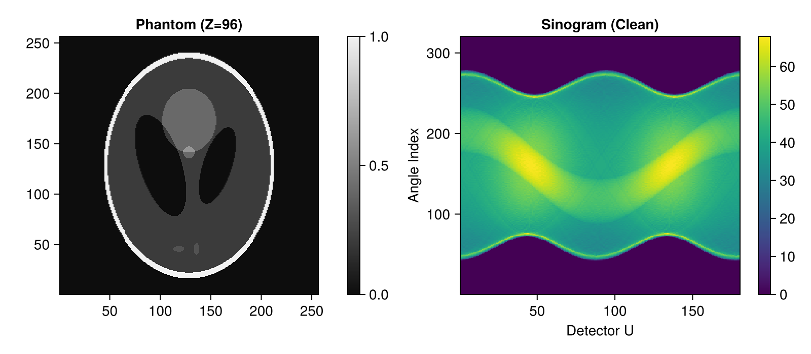
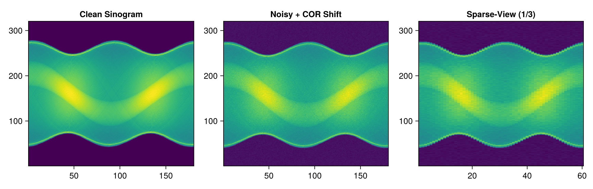
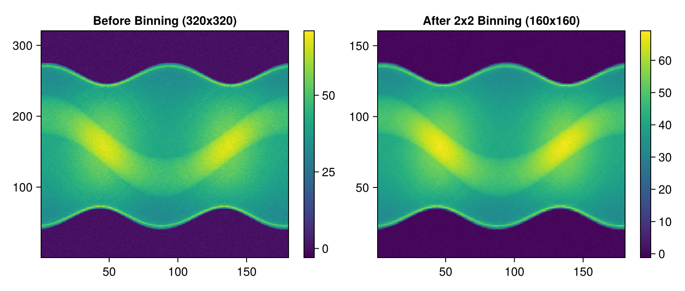
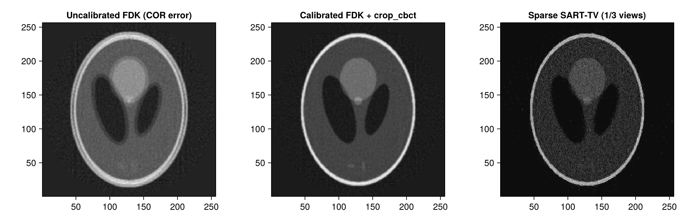

# CT Projection Preprocessing & Pipeline Demo with Tigre.jl

This tutorial demonstrates an end-to-end computed tomography workflow covering:
1. **Step 1: Clean Data Preparation**: 3D Shepp-Logan phantom synthesis and cone-beam forward projection (`Ax`).
2. **Step 2: Realistic Acquisition Artifacts & Noise**:
   - Centre-of-rotation (COR) misalignment.
   - Low-dose transmission noise simulation (`add_ct_noise`) via the Beer-Lambert attenuation model.
   - Sparse-view angle downsampling (`subsample_angles`).
3. **Step 3: Projection Preprocessing & Geometry Adaptation**:
   - Automatic COR offset estimation and alignment (`computeCOR`).
   - Spatial detector binning and geometry synchronization (`binning`).
   - Redundancy weighting for short-scans (`parkerweight!`).
4. **Step 4: Reconstruction, FOV Masking, and Quality Assessment**:
   - Analytical (FDK) and iterative (SART / SART-TV) reconstruction.
   - Cylindrical Field of View (FOV) cropping (`crop_cbct!`).
   - Quantitative image fidelity evaluation (`measure_quality`: PSNR, SSIM, RMSE, NCC).

---
### Relevant Tigre.jl Functions
- `Tigre.computeCOR`: Estimates center-of-rotation offset from sinograms.
- `Tigre.binning`: Downsamples detector projections and adapts Geometry.
- `Tigre.subsample_angles`: Angular subsampling for sparse-view CT.
- `Tigre.add_ct_noise`: Realistic Poisson quantum and Gaussian electronic noise.
- `Tigre.parkerweight!`: Redundancy smooth weighting for short-scan geometries.
- `Tigre.crop_cbct!`: In-place zero-allocation cylindrical FOV masking.
- `Tigre.measure_quality`: Quantitative evaluation (RMSE, PSNR, SSIM, UQI, NCC).

## Prerequisites
This tutorial uses **Makie** (recommended backend: **CairoMakie**) for visualization.
If `CairoMakie` is not installed in your environment, add it by running `using Pkg; Pkg.add("CairoMakie")`.

```julia
using LinearAlgebra
using Printf
using Random
using CairoMakie
using Tigre
```

## Step 1: Clean Data Preparation

We define a standard 3D cone-beam acquisition geometry and synthesize an analytical Shepp-Logan phantom volume.


```julia
# Configure cone-beam geometry
nangles = 180
angles = LinRange(0f0, 2f0 * Float32(pi), nangles + 1)[1:end-1] |> collect

geo = Geometry(
    mode = :cone,
    angles = angles,
    nVoxel = (256, 256, 256),
    sVoxel = (256f0, 256f0, 256f0),
    nDetector = (320, 320),
    sDetector = (480f0, 480f0),
    DSO = 1000f0,
    DSD = 1500f0,
)

# Generate analytical 3D Shepp-Logan phantom
phantom = shepp_logan_3d(volume_size(geo))

# Compute ground-truth forward projections
clean_projections = Ax(phantom, geo)

println("Volume size:      ", size(phantom))
println("Projections size: ", size(clean_projections))

# Display axial slice (Z = 3N/8) and sinogram
mid_z = 3 * size(phantom, 3) ÷ 8
mid_v = size(clean_projections, 2) ÷ 2

fig = Figure(size = (800, 350))
ax1 = Axis(fig[1, 1], title = "Phantom (Z=$mid_z)", aspect = DataAspect())
hm1 = heatmap!(ax1, phantom[:, :, mid_z], colormap = :grays)
Colorbar(fig[1, 2], hm1)

ax2 = Axis(fig[1, 3], title = "Sinogram (Clean)", xlabel = "Detector U", ylabel = "Angle Index")
hm2 = heatmap!(ax2, clean_projections[:, mid_v, :]', colormap = :viridis)
Colorbar(fig[1, 4], hm2)
fig
```

```text
Volume size:      (256, 256, 256)
Projections size: (320, 320, 180)
```



## Step 2: Realistic Acquisition Artifacts & Noise Simulation

In real CT imaging, raw detector projections suffer from physical non-idealities:
- **Center of Rotation (COR) offset**: Misalignment between detector origin and rotational axis.
- **Quantum & Electronic Noise**: Low-dose protocols reduce photon counts, producing Poisson noise.
- **Sparse Angular Sampling**: High-speed or low-dose imaging protocols acquire fewer projections.


```julia
# 1. Simulate COR misalignment by introducing a physical offset (+2.5 mm)
cor_offset_true = 2.5f0
geo_misaligned = Geometry(
    mode = geo.mode,
    angles = geo.angles,
    nVoxel = geo.nVoxel,
    sVoxel = geo.sVoxel,
    nDetector = geo.nDetector,
    sDetector = geo.sDetector,
    DSO = geo.DSO,
    DSD = geo.DSD,
    COR = cor_offset_true,
)
projections_misaligned = Ax(phantom, geo_misaligned)

# 2. Add realistic CT transmission noise (low dose: I0 = 10,000 incident photons)
rng = Random.MersenneTwister(42)
noisy_projections = add_ct_noise(
    projections_misaligned;
    I0 = 10000.0,              # Lower photon count = lower radiation dose
    gaussian = (0f0, 0.5f0),   # Electronic readout noise
    poisson = true,
    rng = rng,
)

# 3. Simulate sparse-view CT (subsample by factor of 3 -> 60 projections)
sparse_projections, sparse_geo = subsample_angles(noisy_projections, geo_misaligned, 3)

println("Full view projections:   ", size(noisy_projections, 3))
println("Sparse view projections: ", size(sparse_projections, 3))

fig = Figure(size = (1000, 320))
ax1 = Axis(fig[1, 1], title = "Clean Sinogram")
heatmap!(ax1, clean_projections[:, mid_v, :]', colormap = :viridis)

ax2 = Axis(fig[1, 2], title = "Noisy + COR Shift")
heatmap!(ax2, noisy_projections[:, mid_v, :]', colormap = :viridis)

ax3 = Axis(fig[1, 3], title = "Sparse-View (1/3)")
heatmap!(ax3, sparse_projections[:, mid_v, :]', colormap = :viridis)
fig
```

```text
Full view projections:   180
Sparse view projections: 60
```



## Step 3: Projection Preprocessing & Alignment

Now we apply `Tigre.jl` preprocessing utilities to clean and prepare the data before reconstruction:
1. **`computeCOR`**: Automatically estimate the unknown COR displacement.
2. **`binning`**: Downsample detector spatial resolution to boost SNR and accelerate reconstruction.


```julia
# 1. Automatic Centre-of-Rotation (COR) Estimation
estimated_cor = computeCOR(noisy_projections, geo)
@printf("True COR offset:      %+.3f mm\n", cor_offset_true)
@printf("Estimated COR offset: %+.3f mm (Error: %.4f mm)\n", estimated_cor, abs(estimated_cor - cor_offset_true))

# Calibrate geometry with estimated COR
geo_calibrated = Geometry(
    mode = geo.mode,
    angles = geo.angles,
    nVoxel = geo.nVoxel,
    sVoxel = geo.sVoxel,
    nDetector = geo.nDetector,
    sDetector = geo.sDetector,
    DSO = geo.DSO,
    DSD = geo.DSD,
    COR = estimated_cor,
)

# 2. 2x2 Spatial Binning of Detector Data
# Simultaneously downsamples projections and updates Geometry (nDetector, dDetector, sDetector)
binned_proj, binned_geo = binning(noisy_projections, geo_calibrated, 2; mode = :mean)

println("Original detector dimensions: ", geo_calibrated.nDetector, " pitch: ", geo_calibrated.dDetector)
println("Binned detector dimensions:   ", binned_geo.nDetector, " pitch: ", binned_geo.dDetector)

fig = Figure(size = (800, 340))
ax1 = Axis(fig[1, 1], title = "Before Binning (320x320)")
hm1 = heatmap!(ax1, noisy_projections[:, mid_v, :]', colormap = :viridis)
Colorbar(fig[1, 2], hm1)

ax2 = Axis(fig[1, 3], title = "After 2x2 Binning (160x160)")
hm2 = heatmap!(ax2, binned_proj[:, binned_geo.nDetector[2] ÷ 2, :]', colormap = :viridis)
Colorbar(fig[1, 4], hm2)
fig
```

```text
True COR offset:      +2.500 mm
Estimated COR offset: +2.288 mm (Error: 0.2124 mm)
Original detector dimensions: (320, 320) pitch: (1.5f0, 1.5f0)
Binned detector dimensions:   (160, 160) pitch: (3.0f0, 3.0f0)
```



## Step 4: Reconstruction, FOV Masking & Quality Assessment

We now reconstruct the processed projections, apply Field of View (FOV) cropping to remove peripheral artifacts, and quantify image restoration using `measure_quality`.


```julia
# Reconstruct without COR correction (severe double-edge / ring blur)
rec_uncorrected = fdk(noisy_projections, geo; filter = :hann)

# Reconstruct with COR calibration
rec_corrected = fdk(noisy_projections, geo_calibrated; filter = :hann)

# Iterative SART-TV reconstruction (robust against noise and sparse views)
sparse_projections_cal, sparse_geo_cal = subsample_angles(noisy_projections, geo_calibrated, 3)
rec_sart_tv = sart_tv(sparse_projections_cal, sparse_geo_cal, 10; lambda = 0.5f0, tviter = 8, tvlambda = 100f0)

# Apply cylindrical Field-of-View (FOV) cropping
crop_cbct!(rec_uncorrected, geo)
crop_cbct!(rec_corrected, geo_calibrated)
crop_cbct!(rec_sart_tv, sparse_geo_cal)

# Evaluate quantitative quality against ground truth phantom
q_uncorr = measure_quality(phantom, rec_uncorrected)
q_corr   = measure_quality(phantom, rec_corrected)
q_tv     = measure_quality(phantom, rec_sart_tv)

println("=== Quantitative Reconstruction Quality ===")
@printf("Uncalibrated FDK: PSNR = %5.2f dB | SSIM = %.4f | RMSE = %.4f\n", q_uncorr.psnr, q_uncorr.ssim, q_uncorr.rmse)
@printf("Calibrated FDK:   PSNR = %5.2f dB | SSIM = %.4f | RMSE = %.4f\n", q_corr.psnr, q_corr.ssim, q_corr.rmse)
@printf("Sparse SART-TV:   PSNR = %5.2f dB | SSIM = %.4f | RMSE = %.4f\n", q_tv.psnr, q_tv.ssim, q_tv.rmse)

# Visualize axial slices (Z = 3N/8)
fig = Figure(size = (1100, 350))
ax1 = Axis(fig[1, 1], title = "Uncalibrated FDK (COR error)", aspect = DataAspect())
heatmap!(ax1, rec_uncorrected[:, :, mid_z], colormap = :grays)

ax2 = Axis(fig[1, 2], title = "Calibrated FDK + crop_cbct", aspect = DataAspect())
heatmap!(ax2, rec_corrected[:, :, mid_z], colormap = :grays)

ax3 = Axis(fig[1, 3], title = "Sparse SART-TV (1/3 views)", aspect = DataAspect())
heatmap!(ax3, rec_sart_tv[:, :, mid_z], colormap = :grays)
fig
```

```text
=== Quantitative Reconstruction Quality ===
Uncalibrated FDK: PSNR = 21.69 dB | SSIM = 0.7782 | RMSE = 0.1154
Calibrated FDK:   PSNR = 28.32 dB | SSIM = 0.9616 | RMSE = 0.0513
Sparse SART-TV:   PSNR = 28.52 dB | SSIM = 0.9501 | RMSE = 0.0614
```



## Summary & Best Practices

- **`computeCOR`** automatically resolves rotational misalignment and eliminates severe double-contour artifacts without hardware recalibration.
- **`binning`** accelerates processing and suppresses electronic noise by spatially integrating detector pixels while automatically adapting `Geometry`.
- **`subsample_angles`** enables standardized sparse-view CT benchmarks with synchronized multi-parameter geometry slicing.
- **`add_ct_noise`** accurately reproduces clinical Poisson quantum statistics and electronic readout noise.
- **`crop_cbct!`** provides zero-allocation in-place cylindrical masking of out-of-FOV divergence.
- **`measure_quality`** enables objective, publication-grade benchmark evaluations (PSNR, SSIM, RMSE, NCC).


