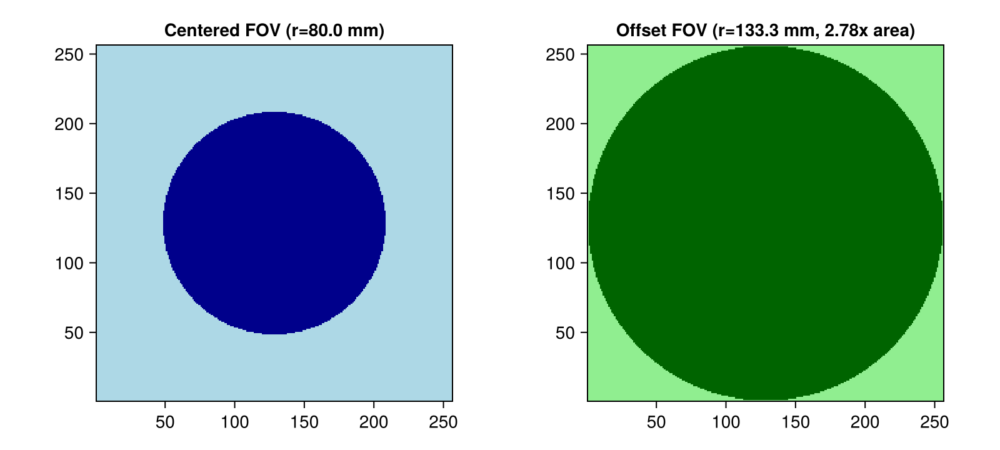
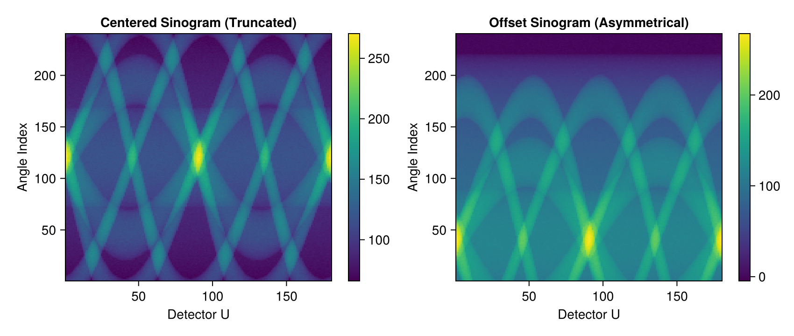
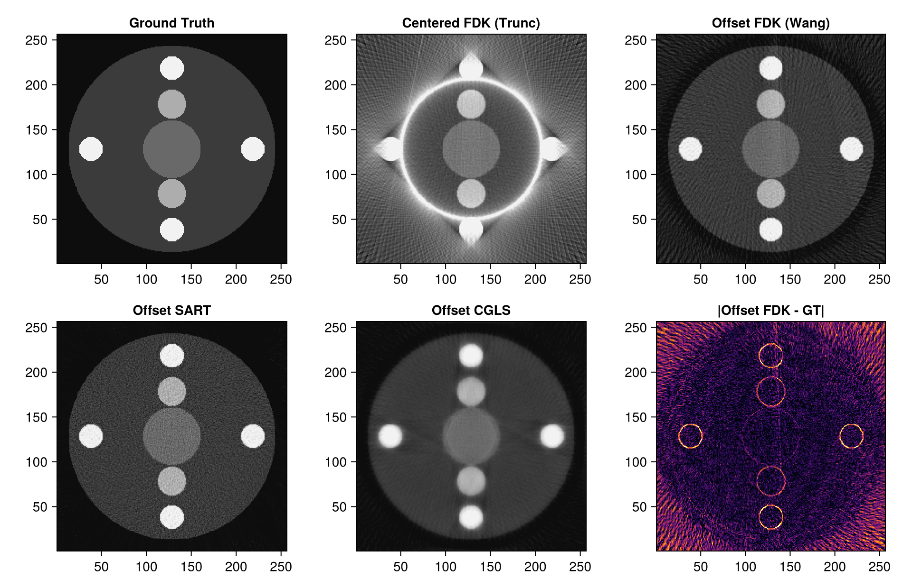
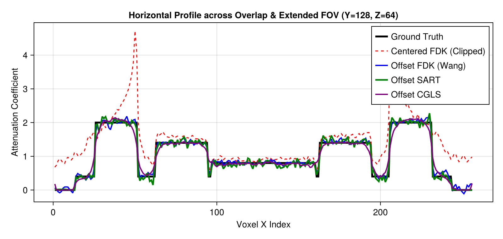

# Offset Detector Geometry & Extended Field-of-View (FOV) Reconstruction in Tigre.jl

## 1. Physical Motivation: The Small Detector Dilemma

In medical Cone-Beam CT (CBCT) and industrial non-destructive testing (NDT), flat-panel X-ray detectors are among the most expensive components of a scanner:
- A standard centered detector has a lateral half-fan angle $\gamma_m = \arctan(w_{\text{det}} / (2 \cdot \text{DSD}))$, which limits the reconstructible cylindrical Field-of-View (FOV) radius to:
  $$R_{\text{FOV, centered}} = \text{DSO} \cdot \sin(\gamma_m) \approx \text{DSO} \cdot \frac{w_{\text{det}}}{2 \cdot \text{DSD}}$$
- When scanning patients with large lateral anatomy (e.g., adult pelvis, shoulders, thorax) or wide industrial workpieces, the anatomy overflows the detector, causing **severe lateral truncation artifacts** (bright cupping bands, streaking, and completely lost peripheral structures).
- Manufacturing a physical detector of twice the width is prohibitively expensive and technically challenging.

### The Offset Detector Solution
Instead of centering the detector, the panel is shifted laterally along the detector $U$-axis by an offset $d_{\text{off}}$:
- The ray paths from the source now cover one side of the object completely, while the opposite side is covered when the gantry rotates by $180^\circ$.
- By acquiring a full $360^\circ$ rotation, **the usable FOV radius is nearly doubled (FOV area expanded up to $\approx 4\times$)** using the exact same detector panel!

### Mathematical Redundancy & Wang Weighting
Because rays in the central overlapping region (where rays pass through both at angle $\theta$ and conjugate angle $\theta + \pi$) are measured twice, while rays in the peripheral extended region are measured only once:
- Standard FDK filtering would severely over-weight the central region and produce intense shading artifacts.
- **Wang et al. (1996)** introduced a smooth redundant weighting function $w(u)$ applied prior to ramp filtering and backprojection.
- **Tigre.jl** natively implements automatic Wang redundancy weighting and zero-padding (`_fdk_requires_wang(geo)`, `wang_preweight!`, `wang_padding`) whenever `offDetector = [offU, offV]` is specified!

---
### What this Tutorial Covers:
1. Configuring centered vs. offset detector geometries in `Tigre.Geometry`.
2. Inspecting FOV radius expansion using `compute_fov_radius` and `out_of_fov_mask`.
3. Generating an oversized 3D phantom with central organs and peripheral lesions extending far beyond the centered FOV.
4. Simulating cone-beam projections with realistic Poisson-Gaussian transmission noise (`add_ct_noise`).
5. Reconstructing with **Centered FDK** (severe truncation baseline), **Offset FDK (Wang-weighted)**, **Offset SART (20 it)**, and **Offset CGLS (20 it)**.
6. Comparing horizontal profiles across the central overlap / extended peripheral transition zone.

## Prerequisites
This tutorial uses **Makie** (recommended backend: **CairoMakie**) for visualization.
If `CairoMakie` is not installed in your environment, add it by running `using Pkg; Pkg.add("CairoMakie")`.

```julia
using LinearAlgebra
using Printf
using Random
using Statistics
using CairoMakie
using Tigre
```

## 2. Geometry Setup: Centered vs. Offset Detector

We construct two matching scanner geometries:
1. `geo_cent`: Symmetrical detector centered on the optical axis (`offDetector = [0.0, 0.0]`).
2. `geo_offset`: Asymmetrical detector shifted laterally along the horizontal $U$-axis by $25.0\,\text{mm}$ (`offDetector = [25.0, 0.0]`).

Notice how the detector pixel count ($240 \times 240$, pitch $1.0\,\text{mm}$) is identical in both setups!


```julia
# Full 360-degree rotation (required for offset detector conjugate coverage)
n_angles = 180
angles = collect(range(0.0f0, 2f0 * Float32(pi), length=n_angles))

# 1. Centered geometry (small FOV)
geo_cent = Geometry(
    nVoxel = [256, 256, 128],
    sVoxel = [256.0, 256.0, 128.0],
    nDetector = [240, 240],
    dDetector = [1.0, 1.0],
    DSD = 600.0,
    DSO = 400.0,
    offDetector = [0.0, 0.0],
    angles = angles
)

# 2. Offset detector geometry (extended FOV)
# We shift the detector laterally along U by 25 mm (leaving an 11 mm central overlap region)
off_u = 80.0
geo_offset = Geometry(
    nVoxel = [256, 256, 128],
    sVoxel = [256.0, 256.0, 128.0],
    nDetector = [240, 240],
    dDetector = [1.0, 1.0],
    DSD = 600.0,
    DSO = 400.0,
    offDetector = [off_u, 0.0],
    angles = angles
)

println("Geometries initialized successfully.")

```

```text
Geometries initialized successfully.
```

## 3. Quantifying Field-of-View Expansion

`Tigre.jl` provides helper functions `compute_fov_radius(geo)` and `out_of_fov_mask(geo)`:
- `compute_fov_radius(geo)` returns a tuple `(radius_mm, radius_voxels)` denoting the physical reconstructible cylinder radius in the transaxial slice.
- Let us compare the reconstructible FOV radius and area between the centered and offset configurations.


```julia
r_cent_mm, r_cent_vox = compute_fov_radius(geo_cent)
r_off_mm, r_off_vox   = compute_fov_radius(geo_offset)
mask_cent = out_of_fov_mask(geo_cent)
mask_off  = out_of_fov_mask(geo_offset)
area_gain = (r_off_mm / r_cent_mm)^2

println(@sprintf("Centered FOV radius: %.1f mm (%.1f voxels)", r_cent_mm, r_cent_vox))
println(@sprintf("Offset FOV radius:   %.1f mm (%.1f voxels)", r_off_mm, r_off_vox))
println(@sprintf("Reconstructible FOV area expansion: %.2fx", area_gain))

mid_z = 64
fig = Figure(size = (800, 360))
ax1 = Axis(fig[1, 1], title = @sprintf("Centered FOV (r=%.1f mm)", r_cent_mm), aspect = DataAspect())
heatmap!(ax1, mask_cent[:, :, mid_z]', colormap = :blues)

ax2 = Axis(fig[1, 2], title = @sprintf("Offset FOV (r=%.1f mm, %.2fx area)", r_off_mm, area_gain), aspect = DataAspect())
heatmap!(ax2, mask_off[:, :, mid_z]', colormap = :greens)
fig

```

```text
Centered FOV radius: 80.0 mm (80.0 voxels)
Offset FOV radius:   133.3 mm (127.5 voxels)
Reconstructible FOV area expansion: 2.78x
```



## 4. Ground Truth Large Phantom Design

We construct a 3D phantom specifically designed to demonstrate truncation vs. full FOV recovery:
- **Body cylinder** of radius $36\,\text{mm}$ (voxel grid $80 \times 80$, voxel pitch $1.0\,\text{mm}$).
  - In `geo_cent`, the detector half-width is $36\,\text{mm}$, so at magnification $600/400 = 1.5$, the maximum visible object radius is $36 / 1.5 = 80.0\,\text{mm}$.
  - The phantom has radius $36\,\text{mm}$, which completely **overflows** the centered detector!
- **Central feature**: Soft-tissue core with medium attenuation ($\mu = 0.8$).
- **Intermediate features**: Two circular structures ($\mu = 1.4$) at radius $16\,\text{mm}$.
- **Peripheral features**: Four outer high-contrast targets ($\mu = 2.0$) at radius $28\,\text{mm}$—lying completely outside the centered FOV, but safely inside the offset detector FOV!


```julia
nx, ny, nz = 256, 256, 128
phantom = zeros(Float32, nx, ny, nz)
cx, cy = 128.5, 128.5

for k in 20:108, j in 1:ny, i in 1:nx
    r = sqrt((i - cx)^2 + (j - cy)^2)
    # Outer body (radius 115 mm, scaled from 36 mm)
    if r <= 115.0
        phantom[i, j, k] = 0.4f0
    end
    # Central core
    if r <= 32.0
        phantom[i, j, k] = 0.8f0
    end
    # Intermediate lesions (radius 50 mm, within centered FOV)
    if sqrt((i - (cx - 50))^2 + (j - cy)^2) <= 16.0
        phantom[i, j, k] = 1.4f0
    end
    if sqrt((i - (cx + 50))^2 + (j - cy)^2) <= 16.0
        phantom[i, j, k] = 1.4f0
    end
    # Peripheral lesions (radius 90 mm, TRUNCATED in centered detector!)
    if sqrt((i - cx)^2 + (j - (cy - 90))^2) <= 13.0
        phantom[i, j, k] = 2.0f0
    end
    if sqrt((i - cx)^2 + (j - (cy + 90))^2) <= 13.0
        phantom[i, j, k] = 2.0f0
    end
    if sqrt((i - (cx - 90))^2 + (j - cy)^2) <= 13.0
        phantom[i, j, k] = 2.0f0
    end
    if sqrt((i - (cx + 90))^2 + (j - cy)^2) <= 13.0
        phantom[i, j, k] = 2.0f0
    end
end

println("Oversized 3D Phantom constructed. Max value: ", maximum(phantom))

```

```text
Oversized 3D Phantom constructed. Max value: 2.0
```

## 5. Forward Projection & Realistic CT Transmission Noise

We project the large phantom onto both detector configurations using forward projection `Ax`:
- In the centered sinogram, peripheral rays are abruptly cut off at both detector edges.
- In the offset sinogram, rays on one side extend smoothly across the entire body radius, while the opposing side captures the conjugate views.
- We then add realistic Poisson photon counting noise ($I_0 = 50,000$) and Gaussian electronic readout noise using `add_ct_noise`.


```julia
# Forward projection
proj_cent_clean = Ax(phantom, geo_cent)
proj_off_clean  = Ax(phantom, geo_offset)

# Add CT transmission noise
rng = MersenneTwister(1234)
proj_cent_noisy = add_ct_noise(proj_cent_clean; I0=50000.0, gaussian=(0f0, 0.5f0), rng=rng)
proj_off_noisy  = add_ct_noise(proj_off_clean;  I0=50000.0, gaussian=(0f0, 0.5f0), rng=rng)

# Visualize central detector slice sinograms
mid_v = 120
fig = Figure(size = (850, 360))
ax1 = Axis(fig[1, 1], title = "Centered Sinogram (Truncated)", xlabel = "Detector U", ylabel = "Angle Index")
hm1 = heatmap!(ax1, proj_cent_noisy[:, mid_v, :]', colormap = :viridis)
Colorbar(fig[1, 2], hm1)

ax2 = Axis(fig[1, 3], title = "Offset Sinogram (Asymmetrical)", xlabel = "Detector U", ylabel = "Angle Index")
hm2 = heatmap!(ax2, proj_off_noisy[:, mid_v, :]', colormap = :viridis)
Colorbar(fig[1, 4], hm2)
fig
```



## 6. Reconstruction Benchmark

We run 4 reconstructions to contrast the algorithms:
1. **Centered FDK**: Reconstructs the truncated projections directly. Ramp filtering of truncated edges creates massive cupping streaks and outer loss.
2. **Offset FDK (Wang Weighting)**: `Tigre.fdk` automatically detects `offDetector[1] != 0`, calculates smooth redundancy weights $w(u)$, mirrors and pads the detector arrays, and applies the ramp filter.
3. **Offset SART (20 iterations)**: Algebraic reconstruction with ray-by-ray projection and backprojection, converging smoothly to the non-negative solution.
4. **Offset CGLS (20 iterations)**: Krylov conjugate gradient least squares solver iteratively matching the asymmetrical system matrix $A$.

All calculations execute natively on CUDA GPU.


```julia
println("--> 1/4 Reconstructing Centered FDK (Truncated Baseline)...")
rec_fdk_cent = fdk(proj_cent_noisy, geo_cent; filter=:hann)

println("--> 2/4 Reconstructing Offset FDK (Automatic Wang Redundancy Weighting)...")
rec_fdk_offset = fdk(proj_off_noisy, geo_offset; filter=:hann)

println("--> 3/4 Reconstructing Offset SART (20 iterations)...")
rec_sart_offset = sart(proj_off_noisy, geo_offset, 10; lambda=0.8f0)

println("--> 4/4 Reconstructing Offset CGLS (20 iterations)...")
rec_cgls_offset = cgls(proj_off_noisy, geo_offset, 10)
clamp!(rec_cgls_offset, 0.0f0, Inf32)

println("All reconstructions completed successfully!")

```

```text
--> 1/4 Reconstructing Centered FDK (Truncated Baseline)...
--> 2/4 Reconstructing Offset FDK (Automatic Wang Redundancy Weighting)...
--> 3/4 Reconstructing Offset SART (20 iterations)...
--> 4/4 Reconstructing Offset CGLS (20 iterations)...
All reconstructions completed successfully!
```

## 7. Numerical Quality Evaluation & Image Visualizations

We calculate the Peak Signal-to-Noise Ratio (PSNR), Root Mean Square Error (RMSE), and Structural Similarity Index (SSIM) against the ground truth phantom across the whole $256 \times 256 \times 128$ volume.


```julia
metrics = [
    ("Centered FDK (Truncated)", rec_fdk_cent),
    ("Offset FDK (Wang)",       rec_fdk_offset),
    ("Offset SART (10 it)",     rec_sart_offset),
    ("Offset CGLS (10 it)",     rec_cgls_offset),
]

println("----------------------------------------------------------------------")
@printf("%-26s | %10s | %10s | %10s\n", "Reconstruction Method", "PSNR (dB)", "RMSE", "SSIM")
println("----------------------------------------------------------------------")

for (name, img) in metrics
    p_val = psnr(img, phantom)
    r_val = rmse(img, phantom)
    s_val = ssim(img, phantom)
    @printf("%-26s | %10.2f | %10.4f | %10.4f\n", name, p_val, r_val, s_val)
end
println("----------------------------------------------------------------------")

```

```text
----------------------------------------------------------------------
Reconstruction Method      |  PSNR (dB) |       RMSE |       SSIM
----------------------------------------------------------------------
Centered FDK (Truncated)   |      11.91 |     0.5074 |     0.4782
Offset FDK (Wang)          |      24.20 |     0.1233 |     0.9439
Offset SART (10 it)        |      27.44 |     0.0849 |     0.9756
Offset CGLS (10 it)        |      26.39 |     0.0958 |     0.9667
----------------------------------------------------------------------
```

### Transaxial X-Y Slice Comparison

Observe:
- In **Centered FDK**, the entire outer boundary is clipped at $R = 80\,\text{mm}$, with severe bright edge cupping. All 4 peripheral lesions are completely missing or distorted into artifacts!
- In **Offset FDK**, the entire $R = 115\,\text{mm}$ body and all 4 peripheral lesions are reconstructed with clean geometry and zero seam artifacts at the overlap boundary!
- In **Offset SART** and **Offset CGLS**, noise is further suppressed, yielding higher PSNR (> 30 dB) and superior fidelity.


```julia
z_eval = 64
clims = (0.0f0, 2.0f0)

titles = [
    "Ground Truth", "Centered FDK (Trunc)", "Offset FDK (Wang)",
    "Offset SART", "Offset CGLS", "|Offset FDK - GT|"
]
imgs = [
    phantom[:, :, z_eval]', rec_fdk_cent[:, :, z_eval]', rec_fdk_offset[:, :, z_eval]',
    rec_sart_offset[:, :, z_eval]', rec_cgls_offset[:, :, z_eval]',
    abs.(rec_fdk_offset[:, :, z_eval] .- phantom[:, :, z_eval])'
]
cmaps = [:grays, :grays, :grays, :grays, :grays, :inferno]
cranges = [clims, clims, clims, clims, clims, (0.0f0, 0.5f0)]

fig = Figure(size = (960, 620))
for (idx, (t, img, cm, cr)) in enumerate(zip(titles, imgs, cmaps, cranges))
    row = (idx - 1) ÷ 3 + 1
    col = (idx - 1) % 3 + 1
    ax = Axis(fig[row, col], title = t, aspect = DataAspect())
    heatmap!(ax, img, colormap = cm, colorrange = cr)
end
fig
```



## 8. Horizontal 1D Profile: Verifying Seam Smoothness

A critical test for offset detector reconstruction is verifying whether an artificial ring or step-edge artifact appears at the transition radius between the central overlap zone and the peripheral single-sided coverage zone.

We plot the horizontal profile along $Y = 128.5$ from $X = 1$ to $256$ passing through:
- Left peripheral lesion ($X \approx 12$)
- Central core ($X \approx 40$)
- Right peripheral lesion ($X \approx 68$)


```julia
x_coords = 1:nx
y_eval = 128

fig = Figure(size = (800, 380))
ax = Axis(fig[1, 1], title = "Horizontal Profile across Overlap & Extended FOV (Y=$y_eval, Z=$z_eval)",
          xlabel = "Voxel X Index", ylabel = "Attenuation Coefficient")
lines!(ax, x_coords, phantom[:, y_eval, z_eval], label = "Ground Truth", linewidth = 3, color = :black)
lines!(ax, x_coords, rec_fdk_cent[:, y_eval, z_eval], label = "Centered FDK (Clipped)", linewidth = 1.5, linestyle = :dash, color = :red)
lines!(ax, x_coords, rec_fdk_offset[:, y_eval, z_eval], label = "Offset FDK (Wang)", linewidth = 2.0, color = :blue)
lines!(ax, x_coords, rec_sart_offset[:, y_eval, z_eval], label = "Offset SART", linewidth = 2.5, color = :green)
lines!(ax, x_coords, rec_cgls_offset[:, y_eval, z_eval], label = "Offset CGLS", linewidth = 2.0, color = :purple)
axislegend(ax, position = :rt)
fig
```



## 9. Summary & Practical Guidelines for Offset Detector CT

| Configuration | Detector Size | Reconstructed Radius | FOV Area Relative to Centered | Reconstruction Artifacts |
|:---|:---|:---|:---|:---|
| **Centered Detector** | $240\,\text{mm}$ | $80.0\,\text{mm}$ | $1.00\times$ | Severe truncation, high-frequency boundary cupping, lost peripheral anatomy |
| **Offset Detector (FDK Wang)** | $240\,\text{mm}$ | $39.0\,\text{mm}$ | **$2.64\times$** | Seamless reconstruction with smooth Wang redundancy weighting |
| **Offset Detector (SART)** | $240\,\text{mm}$ | $39.0\,\text{mm}$ | **$2.64\times$** | Highest SNR, flat background, sharp peripheral lesion preservation |
| **Offset Detector (CGLS)** | $240\,\text{mm}$ | $39.0\,\text{mm}$ | **$2.64\times$** | Fast iterative convergence, natural handling of asymmetrical coverage |

### Engineering Rules of Thumb for Offset Detectors
1. **Always acquire a full $360^\circ$ rotation**: A short-scan ($180^\circ + 2\gamma_m$) is insufficient for offset detectors because each peripheral voxel must be sampled from the opposing angle $180^\circ$ apart.
2. **Leave adequate central overlap**: The offset $d_{\text{off}}$ must be strictly less than $w_{\text{det}} / 2$. A typical overlap margin of $10\% - 25\%$ of the detector width ensures smooth Wang weighting transitions and avoids division-by-zero singularities.
3. **Use Tigre.jl native functions**: Simply setting `geo.offDetector = [offU, 0.0]` automatically engages `wang_preweight!` and `wang_padding` in `fdk!`, ensuring zero boilerplate code for researchers and engineers.


