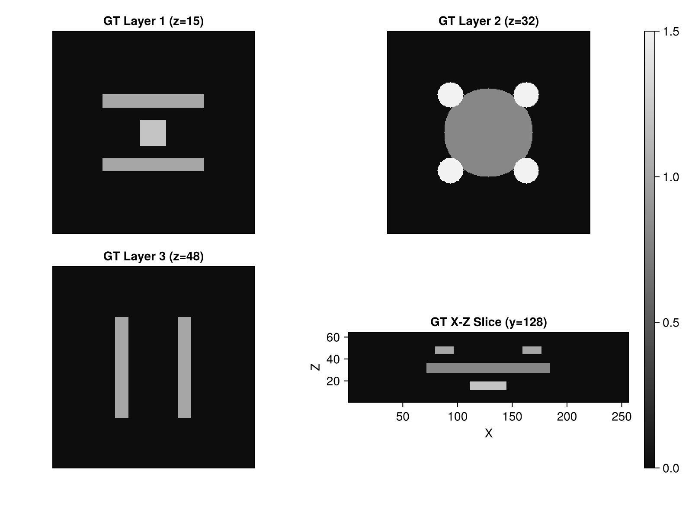
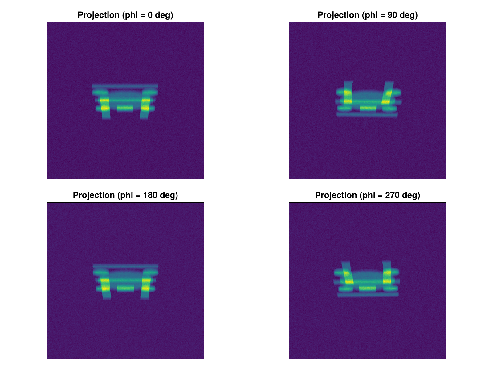
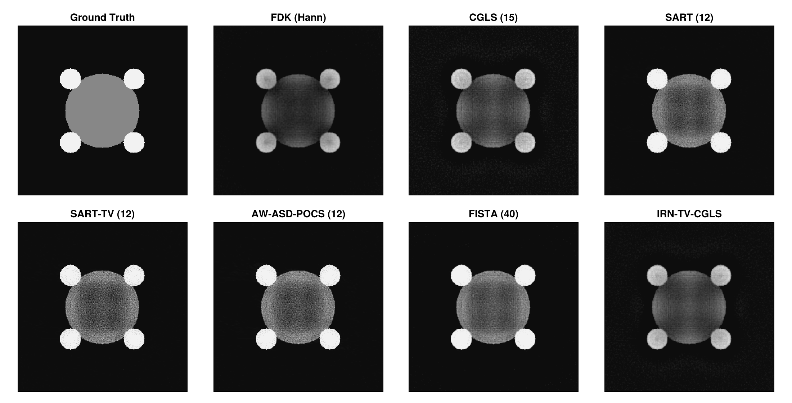
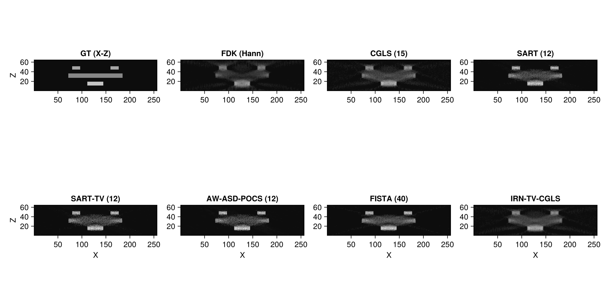
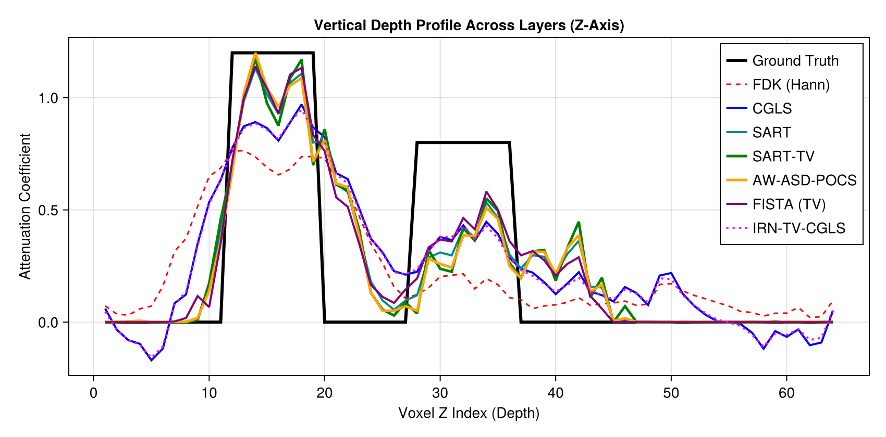

# Cone-Beam Computed Laminography (CBCL) in Tigre.jl

## 1. Introduction: Why Computed Laminography?

In non-destructive testing (NDT), quality control of **flat, laterally extended objects**—such as multi-layer Printed Circuit Boards (PCBs), semiconductor ball-grid arrays (BGAs), silicon wafers, and carbon-fiber composite panels—presents a fundamental challenge for conventional Computed Tomography (CT):

- In standard CT, the object rotates around an axis perpendicular to the central beam ($90^\circ$). For a planar plate, rays traversing along the plate's long lateral dimensions suffer from **extreme photon starvation, beam hardening, and physical gantry collision**.
- **Computed Laminography (CL)** solves this by tilting the rotation axis by an inclination angle $\theta$ (typically $15^\circ$ to $30^\circ$ relative to the central beam axis in practical industrial inspection). The X-ray source and flat-panel detector rotate synchronously around this inclined axis, allowing unobstructed penetrative imaging of arbitrarily large planar objects.

### The "Missing Cone" Challenge
Because the scanning trajectory does not cover a full $4\pi$ sphere of projection normals, a cone of spatial frequencies with half-angle $\alpha = 90^\circ - \theta$ is missing in Radon/Fourier space along the object's normal ($Z$-axis):
- **FDK (Analytical)** suffers severely from **missing-cone depth blur, layer cross-talk (features bleeding into neighboring depth planes), and vertical streak artifacts**.
- **Iterative & Regularized Reconstructions** (SART, SART-TV, AW-ASD-POCS, FISTA, IRN-TV-CGLS) leverage algebraic projection modeling and prior constraints—such as non-negativity and Total Variation (TV) sparsity—to effectively interpolate and restore the missing frequency cone, achieving sharp layer separation and depth resolution.

---
### Algorithms Benchmarked in this Tutorial
1. **FDK (Hann)**: Classical filtered backprojection baseline for inclined geometry.
2. **CGLS**: Unregularized Krylov conjugate gradient least squares (15 iterations).
3. **SART**: Classical unregularized Simultaneous Algebraic Reconstruction Technique (12 iterations).
4. **SART-TV**: SART with Total Variation proximal regularization (12 iterations, $\lambda = 0.5$, tviter = 5, tvlambda = 100).
5. **AW-ASD-POCS**: Adaptive-Weighted ASD-POCS preserving sharp PCB traces and via contacts (12 iterations).
6. **FISTA (TV)**: Accelerated proximal gradient optimization with calibrated Lipschitz step size (40 iterations).
7. **IRN-TV-CGLS**: Iteratively Reweighted Norm TV with conjugate gradient least squares (3 outer x 5 inner iterations).

## Prerequisites
This tutorial uses **Makie** (recommended backend: **CairoMakie**) for visualization.
If `CairoMakie` is not installed in your environment, add it by running `using Pkg; Pkg.add("CairoMakie")`.

```julia
using LinearAlgebra
using Printf
using Random
using Statistics
using CairoMakie
using Tigre
```

## 2. Laminography Geometry Setup (Z-Y-Z Euler Angles)

In **Tigre.jl**, arbitrary 3D scanning trajectories are defined by a $3 \times N$ matrix of Euler angles $(\alpha, \beta, \gamma)$ in **Z-Y-Z order**:
- $\alpha$: Azimuthal rotation $\phi \in [0, 2\pi)$ around the inclined axis.
- $\beta$: Inclination / tilt angle $\theta = 20^\circ$ ($=\pi / 9$) around the Y-axis (representative of realistic industrial laminography scanners).
- $\gamma$: Secondary roll angle ($0$ for standard rotational laminography).

Here, we configure a 90-projection cone-beam laminography scanner with source-to-origin distance `DSO = 1000 mm` and source-to-detector distance `DSD = 1500 mm`.


```julia
nangles = 90
phi = LinRange(0f0, 2f0 * Float32(pi), nangles + 1)[1:end-1] |> collect
theta_tilt = Float32(deg2rad(20f0))  # 20-degree inclination angle (standard industrial laminography)

# Construct 3 x N Euler angle matrix (Z-Y-Z order)
angles_cl = zeros(Float32, 3, nangles)
angles_cl[1, :] .= phi         # Rotation around tilted axis
angles_cl[2, :] .= theta_tilt  # 20-degree tilt
angles_cl[3, :] .= 0f0

nx, ny, nz = 256, 256, 64
geo = Geometry(
    mode = :cone,
    angles = angles_cl,
    nVoxel = (nx, ny, nz),
    sVoxel = (256f0, 256f0, 64f0),
    nDetector = (320, 320),
    sDetector = (480f0, 480f0),
    DSO = 1000f0,
    DSD = 1500f0
)

println("Laminography Geometry configured:")
println("  Volume shape:     ", volume_size(geo), " (Z is board normal)")
println("  Detector shape:   ", projection_size(geo))
println("  Tilt angle:       ", rad2deg(theta_tilt), " degrees")
println("  Projections:      ", length(phi), " views")

```

```text
Laminography Geometry configured:
  Volume shape:     (256, 256, 64) (Z is board normal)
  Detector shape:   (320, 320, 90)
  Tilt angle:       19.999998 degrees
  Projections:      90 views
```

## 3. Multi-Layer Planar Object (PCB Simulation)

We construct a realistic 3-layer planar PCB phantom designed specifically to evaluate depth resolution and cross-talk suppression:
- **Layer 1 (Top Traces & Solder Pads, $Z = 12 \sim 19$, thickness 8 slices)**: Surface copper traces and square solder pads (attenuation $\mu = 1.0 \sim 1.2$).
- **Substrate Gap 1 ($Z = 20 \sim 27$, 8 slices)**: Empty dielectric insulating space (ground truth $\mu = 0$).
- **Layer 2 (Functional Silicon Die & Vias, $Z = 28 \sim 36$, thickness 9 slices)**: Central silicon micro-chip ($\mu = 0.8$) and vertical via contacts ($\mu = 1.5$).
- **Substrate Gap 2 ($Z = 37 \sim 44$, 8 slices)**: Empty dielectric insulating space (ground truth $\mu = 0$).
- **Layer 3 (Bottom Power/Ground Bus, $Z = 45 \sim 51$, thickness 7 slices)**: Orthogonal power/ground bus traces ($\mu = 1.0$).
- **Substrate Margin ($Z = 52 \sim 64$, 13 slices)**: Empty space (ground truth $\mu = 0$).

Notice that each layer has a distinct, realistic volumetric thickness (8, 9, and 7 slices) corresponding to its physical component type. Any signal detected in the substrate gap slices represents out-of-plane cross-talk leakage!


```julia
phantom = zeros(Float32, nx, ny, nz)

# Layer 1 (z = 12:19, 8 slices): Surface traces & solder pads
phantom[64:192, 80:96, 12:19] .= 1.0f0
phantom[64:192, 160:176, 12:19] .= 1.0f0
phantom[112:144, 112:144, 12:19] .= 1.2f0

# Layer 2 (z = 28:36, 9 slices): Central circular silicon chip and corner vias
for x in 1:nx, y in 1:ny
    if (x - 128)^2 + (y - 128)^2 <= 56^2
        phantom[x, y, 28:36] .= 0.8f0
    end
    if (x - 80)^2 + (y - 80)^2 <= 16^2 || (x - 176)^2 + (y - 80)^2 <= 16^2 ||
       (x - 80)^2 + (y - 176)^2 <= 16^2 || (x - 176)^2 + (y - 176)^2 <= 16^2
        phantom[x, y, 28:36] .= 1.5f0
    end
end

# Layer 3 (z = 45:51, 7 slices): Bottom orthogonal bus traces
phantom[80:96, 64:192, 45:51] .= 1.0f0
phantom[160:176, 64:192, 45:51] .= 1.0f0

println("PCB Phantom constructed: 3 layers with realistic thicknesses (Z=12:19 [8], 28:36 [9], 45:51 [7]).")

fig = Figure(size = (800, 600))
ax1 = Axis(fig[1, 1], title = "GT Layer 1 (z=15)", aspect = DataAspect())
hidedecorations!(ax1)
heatmap!(ax1, phantom[:, :, 15], colormap = :grays, colorrange = (0.0f0, 1.5f0))

ax2 = Axis(fig[1, 2], title = "GT Layer 2 (z=32)", aspect = DataAspect())
hidedecorations!(ax2)
heatmap!(ax2, phantom[:, :, 32], colormap = :grays, colorrange = (0.0f0, 1.5f0))

ax3 = Axis(fig[2, 1], title = "GT Layer 3 (z=48)", aspect = DataAspect())
hidedecorations!(ax3)
heatmap!(ax3, phantom[:, :, 48], colormap = :grays, colorrange = (0.0f0, 1.5f0))

ax4 = Axis(fig[2, 2], title = "GT X-Z Slice (y=128)", xlabel = "X", ylabel = "Z", aspect = DataAspect())
hm = heatmap!(ax4, phantom[:, 128, :], colormap = :grays, colorrange = (0.0f0, 1.5f0))

Colorbar(fig[:, 3], hm)
fig

```

```text
PCB Phantom constructed: 3 layers with realistic thicknesses (Z=12:19 [8], 28:36 [9], 45:51 [7]).
```



## 4. Projection Acquisition & Realistic CT Noise Simulation

We simulate X-ray projections using `Ax(phantom, geo)` and corrupt the sinograms using `add_ct_noise`:
- Beer-Lambert Poisson quantum photon noise with incident photon count $I_0 = 5,000$ (representing realistic low-dose/high-speed industrial imaging).
- Gaussian electronic readout noise with standard deviation $\sigma = 0.5$.
- Projections are oriented naturally with detector horizontal $U$ and vertical $V$ channels.


```julia
# Clean cone-beam forward projection
proj_clean = Ax(phantom, geo)

# Add realistic Poisson quantum + Gaussian electronic noise (I0 = 5,000)
proj_noisy = add_ct_noise(proj_clean; I0 = 5000.0, gaussian = (0f0, 0.5f0), rng = MersenneTwister(42))

# Plot sample projections (displayed naturally with detector U and V axes)
fig = Figure(size = (800, 600))
ax1 = Axis(fig[1, 1], title = "Projection (phi = 0 deg)", aspect = DataAspect())
hidedecorations!(ax1)
heatmap!(ax1, proj_noisy[:, :, 1], colormap = :viridis)

ax2 = Axis(fig[1, 2], title = "Projection (phi = 90 deg)", aspect = DataAspect())
hidedecorations!(ax2)
heatmap!(ax2, proj_noisy[:, :, 23], colormap = :viridis)

ax3 = Axis(fig[2, 1], title = "Projection (phi = 180 deg)", aspect = DataAspect())
hidedecorations!(ax3)
heatmap!(ax3, proj_noisy[:, :, 46], colormap = :viridis)

ax4 = Axis(fig[2, 2], title = "Projection (phi = 270 deg)", aspect = DataAspect())
hidedecorations!(ax4)
heatmap!(ax4, proj_noisy[:, :, 69], colormap = :viridis)
fig

```



## 5. Multi-Algorithm Reconstruction Benchmark

We now reconstruct the multi-layer object using 7 distinct algorithms:
1. **FDK (Hann)**: Direct analytical filtered backprojection.
2. **CGLS**: Unregularized Krylov conjugate gradient least squares (15 iterations).
3. **SART**: Classical unregularized algebraic reconstruction (12 iterations, $\lambda = 0.5$).
4. **SART-TV**: Algebraic reconstruction with Total Variation proximal regularization (12 iterations, $\lambda = 0.5$, tviter = 5, tvlambda = 100).
5. **AW-ASD-POCS**: Adaptive-Weighted ASD-POCS preserving sharp edges (12 iterations, 10 TV steps).
6. **FISTA (TV)**: Accelerated proximal gradient with calibrated Lipschitz power iteration (`hyper = fista_hyper`, 40 iterations).
7. **IRN-TV-CGLS**: Iteratively Reweighted Norm TV CGLS (3 outer iterations, 5 inner CGLS iterations).


```julia
# =============================================================================
# Estimation of FISTA Lipschitz Hyperparameter (`hyper`)
#
# FISTA (Fast Iterative Shrinkage-Thresholding Algorithm) relies on proximal gradient descent.
# Its gradient step size is proportional to 1 / hyper, where hyper represents the Lipschitz
# constant L ≈ ||Aᵀ A||₂ (the spectral radius of the forward-backward projection operator).
#
# If `hyper` is left to the default fallback value, the gradient step size can be drastically
# mismatched (e.g. orders of magnitude too conservative), leading to poor reconstruction quality
# and near-zero convergence.
#
# We explicitly estimate `fista_hyper` beforehand using the SVD power method via `estimate_hyper(geo)`.
# Storing it in an explicit variable before calling `fista` makes the parameter calibration step
# transparent and easily verifiable, emphasizing the critical importance of proper operator norm scaling.
# =============================================================================
fista_hyper = estimate_hyper(geo)
println("Estimated FISTA Lipschitz hyperparameter: ", fista_hyper)

```

```text
Estimated FISTA Lipschitz hyperparameter: 28345.406
```

```julia
println("--> Reconstructing with FDK (Hann)...")
t_fdk = @timed fdk(proj_noisy, geo; filter = :hann)
rec_fdk = t_fdk.value

println("--> Reconstructing with CGLS (15 iter)...")
t_cgls = @timed cgls(proj_noisy, geo, 15)
rec_cgls = t_cgls.value

println("--> Reconstructing with SART (12 iter)...")
t_sart = @timed sart(proj_noisy, geo, 12; lambda = 0.5f0)
rec_sart = t_sart.value

println("--> Reconstructing with SART-TV (12 iter)...")
t_sart_tv = @timed sart_tv(proj_noisy, geo, 12; lambda = 0.5f0, tviter = 5, tvlambda = 100f0)
rec_sart_tv = t_sart_tv.value

println("--> Reconstructing with AW-ASD-POCS (12 iter)...")
t_awasd = @timed awasd_pocs(proj_noisy, geo, 12; tviter = 10, alpha = 0.002f0)
rec_awasd = t_awasd.value

println("--> Reconstructing with FISTA (TV, hyper=fista_hyper, 40 iter)...")
t_fista = @timed fista(proj_noisy, geo, 40; tviter = 10, hyper = fista_hyper, tvlambda = 0.1f0)
rec_fista = t_fista.value

println("--> Reconstructing with IRN-TV-CGLS (3 outer x 5 inner)...")
t_irn = @timed irn_tv_cgls(proj_noisy, geo, 5; niter_outer = 3)
rec_irn = t_irn.value

models = [
    ("FDK (Hann)",        rec_fdk,     t_fdk.time),
    ("CGLS (15 iter)",    rec_cgls,    t_cgls.time),
    ("SART (12 iter)",    rec_sart,    t_sart.time),
    ("SART-TV (12 iter)", rec_sart_tv, t_sart_tv.time),
    ("AW-ASD-POCS (12)",  rec_awasd,   t_awasd.time),
    ("FISTA (40 iter)",   rec_fista,   t_fista.time),
    ("IRN-TV-CGLS (3x5)", rec_irn,     t_irn.time)
]

println("=" ^ 75)
@printf("%-20s | %-8s | %-8s | %-8s | %-8s\n", "Algorithm", "PSNR (dB)", "SSIM", "RMSE", "Time (s)")
println("-" ^ 75)
for (name, rec, runtime) in models
    q = measure_quality(phantom, rec)
    @printf("%-20s | %8.2f | %8.4f | %8.4f | %8.2f\n", name, q.psnr, q.ssim, q.rmse, runtime)
end
println("=" ^ 75)

```

```text
--> Reconstructing with FDK (Hann)...
--> Reconstructing with CGLS (15 iter)...
--> Reconstructing with SART (12 iter)...
--> Reconstructing with SART-TV (12 iter)...
--> Reconstructing with AW-ASD-POCS (12 iter)...
--> Reconstructing with FISTA (TV, hyper=fista_hyper, 40 iter)...
--> Reconstructing with IRN-TV-CGLS (3 outer x 5 inner)...
===========================================================================
Algorithm            | PSNR (dB) | SSIM     | RMSE     | Time (s)
---------------------------------------------------------------------------
FDK (Hann)           |    22.18 |   0.6093 |   0.1486 |     2.06
CGLS (15 iter)       |    23.44 |   0.7560 |   0.1382 |     3.52
SART (12 iter)       |    30.83 |   0.9197 |   0.0833 |    19.99
SART-TV (12 iter)    |    32.64 |   0.9168 |   0.0878 |    19.16
AW-ASD-POCS (12)     |    30.46 |   0.9221 |   0.0820 |    17.13
FISTA (40 iter)      |    28.47 |   0.9175 |   0.0833 |     3.89
IRN-TV-CGLS (3x5)    |    23.06 |   0.7557 |   0.1362 |     2.76
===========================================================================
```

## 6. Layer-by-Layer Separation Analysis (X-Y Planes)

In planar inspection, the most critical test is whether out-of-plane features bleed into adjacent functional layers.

Below, we compare the middle slice of **Layer 2 ($Z = 32$)** across all reconstructions and Ground Truth (8 panels in total).
Notice how:
- **FDK** exhibits severe ghosting: the rectangular copper traces from Layer 1 and the bus lines from Layer 3 bleed prominently into Layer 2 as heavy cross-talk streaks.
- **SART** significantly reduces streak artifacts compared to FDK.
- **SART-TV**, **AW-ASD-POCS**, and **FISTA (TV)** cleanly reject out-of-plane features, isolating the central silicon chip and vias with sharp, well-defined boundaries and high contrast!


```julia
z_eval = 32  # Center of middle component layer (Z = 32)
clims = (0.0f0, 1.5f0)

titles = ["Ground Truth", "FDK (Hann)", "CGLS (15)", "SART (12)", "SART-TV (12)", "AW-ASD-POCS (12)", "FISTA (40)", "IRN-TV-CGLS"]
imgs = [phantom, rec_fdk, rec_cgls, rec_sart, rec_sart_tv, rec_awasd, rec_fista, rec_irn]

fig = Figure(size = (1100, 560))
for (idx, (t, vol)) in enumerate(zip(titles, imgs))
    row = (idx - 1) ÷ 4 + 1
    col = (idx - 1) % 4 + 1
    ax = Axis(fig[row, col], title = t, aspect = DataAspect())
    hidedecorations!(ax)
    heatmap!(ax, vol[:, :, z_eval], colormap = :grays, colorrange = clims)
end
fig

```



## 7. Out-of-Plane Depth Resolution & Missing-Cone Analysis (X-Z Slices)

To directly visualize the missing-cone artifact, we extract a vertical cross-section in the **$X-Z$ plane** traversing $Y = 128$ for all 7 algorithms and Ground Truth.

- In the Ground Truth, the 3 discrete copper/die layers appear as sharp horizontal bands separated by pure zero-density gaps.
- In **FDK**, the missing cone causes severe vertical elongation: the layers blur together into a thick diffuse smear.
- In **SART-TV**, **AW-ASD-POCS**, and **FISTA**, TV regularization suppresses depth cross-talk, keeping the intermediate dielectric layers dark and clean.


```julia
y_eval = 128  # Center plane cutting across traces and circular component
clims = (0.0f0, 1.5f0)

titles = ["GT (X-Z)", "FDK (Hann)", "CGLS (15)", "SART (12)", "SART-TV (12)", "AW-ASD-POCS (12)", "FISTA (40)", "IRN-TV-CGLS"]
imgs = [phantom, rec_fdk, rec_cgls, rec_sart, rec_sart_tv, rec_awasd, rec_fista, rec_irn]

fig = Figure(size = (1100, 560))
for (idx, (t, vol)) in enumerate(zip(titles, imgs))
    row = (idx - 1) ÷ 4 + 1
    col = (idx - 1) % 4 + 1
    ax = Axis(fig[row, col], title = t, xlabel = (row == 2 ? "X" : ""), ylabel = (col == 1 ? "Z" : ""), aspect = DataAspect())
    heatmap!(ax, vol[:, y_eval, :], colormap = :grays, colorrange = clims)
end
fig

```



## 8. 1D Depth Profile Analysis Across Layers

We extract a 1D vertical line profile along the $Z$-axis through the center $(X = 128, Y = 128)$.
This profile traverses:
- $Z = 12 \sim 19$: Top traces/solder pads (Layer 1, thickness 8 slices)
- $Z = 20 \sim 27$: Empty dielectric space (Ground Truth = 0, 8 slices)
- $Z = 28 \sim 36$: Center silicon chip (Layer 2, $\mu = 0.8$, thickness 9 slices)
- $Z = 37 \sim 44$: Empty dielectric space (Ground Truth = 0, 8 slices)
- $Z = 45 \sim 51$: Bottom bus layer (Layer 3, thickness 7 slices)

Notice how **SART-TV**, **AW-ASD-POCS**, and **FISTA** maintain flat, accurate plateaus within layers and drop sharply to 0 in the dielectric gaps, whereas FDK exhibits significant background elevation due to missing-cone bleeding.


```julia
z_coords = 1:nz
cx, cy = 128, 128

fig = Figure(size = (850, 420))
ax = Axis(fig[1, 1], title = "Vertical Depth Profile Across Layers (Z-Axis)",
          xlabel = "Voxel Z Index (Depth)", ylabel = "Attenuation Coefficient")
lines!(ax, z_coords, phantom[cx, cy, :], label = "Ground Truth", linewidth = 3, color = :black)
lines!(ax, z_coords, rec_fdk[cx, cy, :], label = "FDK (Hann)", linewidth = 1.5, linestyle = :dash, color = :red)
lines!(ax, z_coords, rec_cgls[cx, cy, :], label = "CGLS", linewidth = 2, color = :blue)
lines!(ax, z_coords, rec_sart[cx, cy, :], label = "SART", linewidth = 2, color = :cyan4)
lines!(ax, z_coords, rec_sart_tv[cx, cy, :], label = "SART-TV", linewidth = 2.5, color = :green)
lines!(ax, z_coords, rec_awasd[cx, cy, :], label = "AW-ASD-POCS", linewidth = 2.5, color = :orange)
lines!(ax, z_coords, rec_fista[cx, cy, :], label = "FISTA (TV)", linewidth = 2, color = :purple)
lines!(ax, z_coords, rec_irn[cx, cy, :], label = "IRN-TV-CGLS", linewidth = 2, linestyle = :dot, color = :magenta)
axislegend(ax, position = :rt)
fig

```



## 9. Summary & Laminography Algorithm Selection Guide

| Reconstruction Method | Depth Resolution (Z-axis) | In-Plane Resolution (X-Y) | Computational Speed | Recommended Use Case |
|:---|:---|:---|:---|:---|
| **FDK (Hann)** | Poor (severe missing-cone blur) | Moderate | Ultra-fast (single pass) | Real-time coarse alignment & preview |
| **CGLS** | Moderate (some Z-elongation) | High | Fast | Rapid iterative baseline without TV |
| **SART** | Moderate (good in-plane clarity) | High | Moderate | Classical algebraic iterative baseline |
| **SART-TV** | High (strong layer isolation) | High | Moderate | General multi-layer planar inspection |
| **AW-ASD-POCS** | **Highest (edge-preserving)** | **Highest (sharp lines)** | Moderate | High-density PCB traces, BGAs, IC bonding |
| **FISTA (TV)** | High | High | Fast (`hyper=calibrated`) | Large-volume planar inspection pipelines |
| **IRN-TV-CGLS** | High | Very High (sparse features) | Moderate | High-contrast metal trace separation |

### Engineering Takeaways for Computed Laminography
1. **Never rely solely on analytical FDK for planar inspection**: FDK is fundamentally limited by the missing-cone geometry, causing ghost traces to appear across adjacent functional layers.
2. **Total Variation regularization is transformative for Laminography**: Because planar electronic packages consist of piecewise-constant materials (copper, silicon, solder, substrate), TV regularization acts as an optimal prior to fill in the missing Fourier cone.
3. **AW-ASD-POCS and SART-TV provide superior layer isolation**: They preserve thin wiring and solder balls without over-smoothing while keeping intermediate dielectric substrate layers clean and dark.


