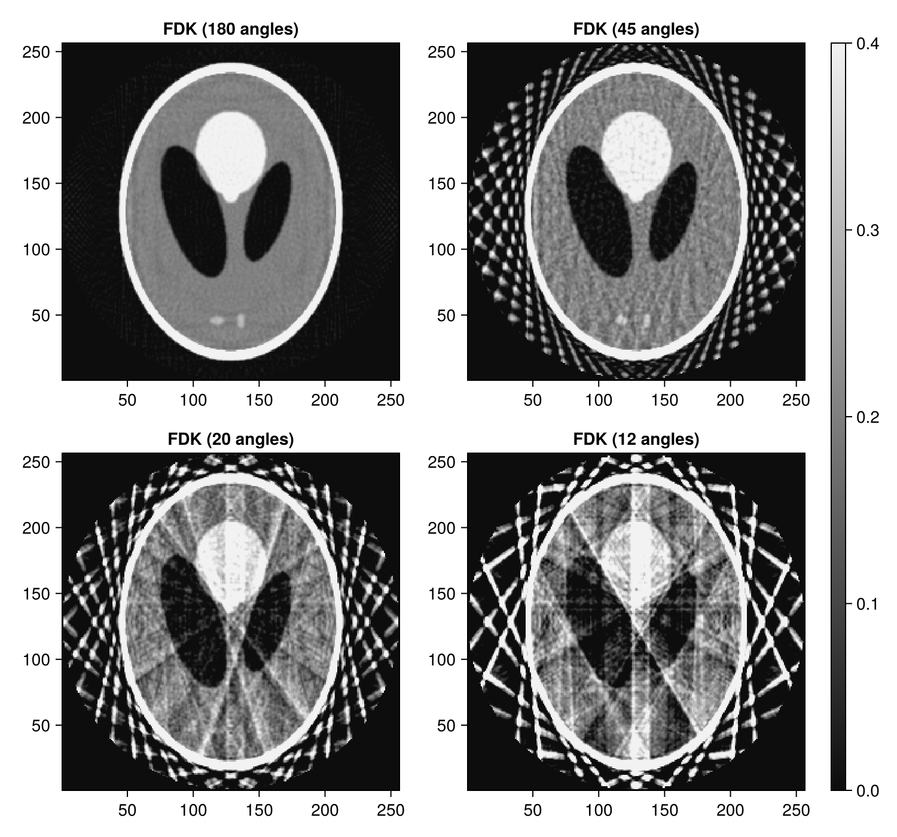
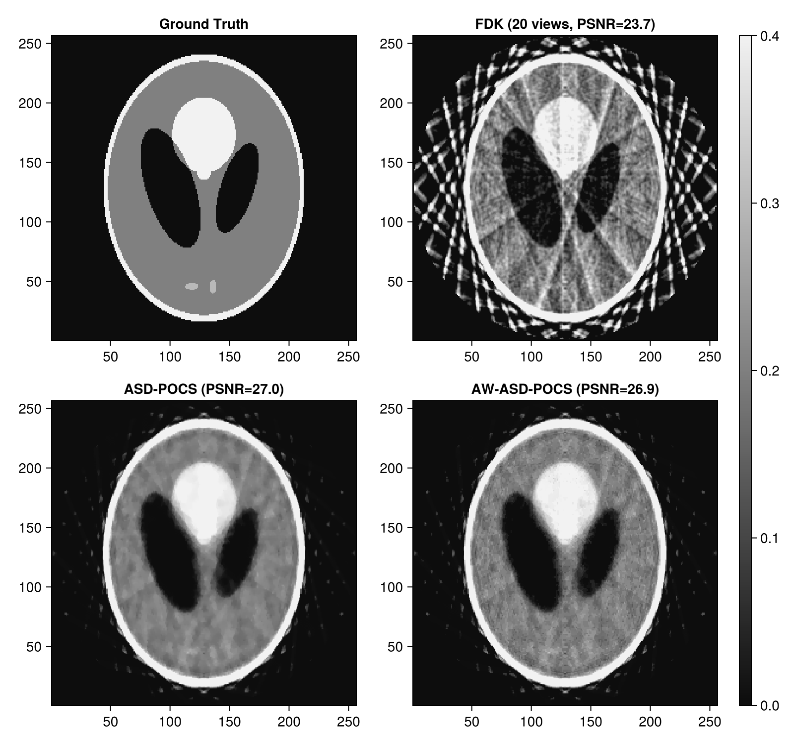
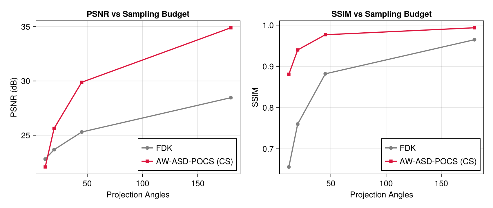

# Sparse-View CT & Compressed Sensing with Tigre.jl

Acquiring fewer projection angles drastically reduces scanning time and radiation dose. However, standard analytical reconstruction (FDK) suffers from severe radial streak artifacts and aliasing when the Nyquist angular sampling criteria is violated.

**Compressed Sensing (CS)** theory proves that sparse signals (such as gradient-sparse tomographic attenuation maps) can be perfectly reconstructed from far fewer measurements than Nyquist limits by solving constrained Total Variation (TV) minimization problems.

This tutorial explores:
1. **Generating sparse-view projection sets** from full-scan data using `subsample_angles`.
2. **Observing aliasing streak artifacts** in analytical FDK across different sampling rates (180, 45, 20, 10 projections).
3. **Restoring streak-free volumes** using advanced CS solvers: **ASD-POCS**, **AW-ASD-POCS**, and **Hybrid-FLSQR-TV**.
4. **Analyzing the Angular Scaling Curve**: Plotting PSNR and SSIM as a function of projection angle count.

---
### Key Tigre.jl Features Demonstrated
- `Tigre.subsample_angles`: Multi-parameter synchronous geometry and projection downsampling.
- `Tigre.asd_pocs`: Adaptive Steepest Descent Projection Onto Convex Sets.
- `Tigre.awasd_pocs`: Edge-preserving Adaptive-Weighted ASD-POCS.
- `Tigre.hybrid_flsqr_tv`: Subspace bidiagonalization with TV preconditioning.
- `Tigre.crop_cbct!`: Zero-allocation in-place cylindrical FOV masking.
- `Tigre.measure_quality`: Quantitative fidelity benchmark (PSNR, SSIM, RMSE, NCC).

## Prerequisites
This tutorial uses **Makie** (recommended backend: **CairoMakie**) for visualization.
If `CairoMakie` is not installed in your environment, add it by running `using Pkg; Pkg.add("CairoMakie")`.

```julia
using LinearAlgebra
using Printf
using Random
using CairoMakie
using Tigre
```

## 1. Ground Truth Volume & Full-View Acquisition

We set up a standard 3D cone-beam acquisition with 180 projections covering a full $360^\circ$ rotation.


```julia
nangles_full = 180
angles_full = LinRange(0f0, 2f0 * Float32(pi), nangles_full + 1)[1:end-1] |> collect

geo_full = Geometry(
    mode = :cone,
    angles = angles_full,
    nVoxel = (256, 256, 256),
    sVoxel = (256f0, 256f0, 256f0),
    nDetector = (320, 320),
    sDetector = (480f0, 480f0),
    DSO = 1000f0,
    DSD = 1500f0,
)

phantom = shepp_logan_3d(volume_size(geo_full))
proj_full = Ax(phantom, geo_full)

println("Full acquisition: $(projection_count(geo_full)) angles, $(size(proj_full)) projections")

```

```text
Full acquisition: 180 angles, (320, 320, 180) projections
```

## 2. Sparse-View Subsampling (`subsample_angles`)

We create systematically downsampled datasets corresponding to 45 angles (1/4 dose), 20 angles (1/9 dose), and 12 angles (1/15 dose).


```julia
proj_45, geo_45 = subsample_angles(proj_full, geo_full, 4)   # 180 / 4 = 45 angles
proj_20, geo_20 = subsample_angles(proj_full, geo_full, 9)   # 180 / 9 = 20 angles
proj_12, geo_12 = subsample_angles(proj_full, geo_full, 15)  # 180 / 15 = 12 angles

println("Subsampled sets created:")
println("  - Rate 1/4:  $(projection_count(geo_45)) angles")
println("  - Rate 1/9:  $(projection_count(geo_20)) angles")
println("  - Rate 1/15: $(projection_count(geo_12)) angles")

```

```text
Subsampled sets created:
  - Rate 1/4:  45 angles
  - Rate 1/9:  20 angles
  - Rate 1/15: 12 angles
```

## 3. Analytical Breakdown: Streak Artifacts in FDK

When angular sampling drops below Nyquist requirements, high-frequency backprojection rays fail to cancel constructively, producing severe radial star streaks.


```julia
fdk_180 = crop_cbct!(fdk(proj_full, geo_full; filter = :hann), geo_full)
fdk_45  = crop_cbct!(fdk(proj_45,   geo_45;   filter = :hann), geo_45)
fdk_20  = crop_cbct!(fdk(proj_20,   geo_20;   filter = :hann), geo_20)
fdk_12  = crop_cbct!(fdk(proj_12,   geo_12;   filter = :hann), geo_12)

mid_z = 3 * size(phantom, 3) ÷ 8
clims = (0.0f0, 0.4f0)

fig = Figure(size = (750, 700))
ax1 = Axis(fig[1, 1], title = "FDK (180 angles)", aspect = DataAspect())
heatmap!(ax1, fdk_180[:, :, mid_z], colormap = :grays, colorrange = clims)

ax2 = Axis(fig[1, 2], title = "FDK (45 angles)", aspect = DataAspect())
heatmap!(ax2, fdk_45[:, :, mid_z], colormap = :grays, colorrange = clims)

ax3 = Axis(fig[2, 1], title = "FDK (20 angles)", aspect = DataAspect())
heatmap!(ax3, fdk_20[:, :, mid_z], colormap = :grays, colorrange = clims)

ax4 = Axis(fig[2, 2], title = "FDK (12 angles)", aspect = DataAspect())
hm = heatmap!(ax4, fdk_12[:, :, mid_z], colormap = :grays, colorrange = clims)

Colorbar(fig[:, 3], hm)
fig
```



## 4. Compressed Sensing Restoration on 20-Angle Data

Using the severely undersampled 20-angle dataset (where FDK is completely overwhelmed by streaks), we test three Compressed Sensing solvers:
1. **ASD-POCS**: Adaptive steepest descent on total variation with data-consistency projections.
2. **AW-ASD-POCS**: Adaptive-Weighted ASD-POCS that preserves delicate edges by moderating TV penalties along strong image gradients.
3. **Hybrid-FLSQR-TV**: Krylov subspace bidiagonalization with TV regularization.


```julia
println("--> Reconstructing 20-angle data with ASD-POCS...")
rec_asd = asd_pocs(proj_20, geo_20, 12; tviter = 10, alpha = 0.002f0)
crop_cbct!(rec_asd, geo_20)

println("--> Reconstructing 20-angle data with AW-ASD-POCS...")
rec_awasd = awasd_pocs(proj_20, geo_20, 12; tviter = 10, alpha = 0.002f0)
crop_cbct!(rec_awasd, geo_20)

println("--> Reconstructing 20-angle data with Hybrid-FLSQR-TV...")
rec_hflsqr = hybrid_flsqr_tv(proj_20, geo_20, 6; lambda = 0.05f0, precond_steps = 3)
crop_cbct!(rec_hflsqr, geo_20)

q_fdk20   = measure_quality(phantom, fdk_20)
q_asd20   = measure_quality(phantom, rec_asd)
q_awasd20 = measure_quality(phantom, rec_awasd)
q_hfl20   = measure_quality(phantom, rec_hflsqr)

println("=" ^ 68)
@printf("20-Angle Algorithm | %10s | %10s | %10s\n", "PSNR (dB)", "SSIM", "RMSE")
println("-" ^ 68)
@printf("%-19s | %10.2f | %10.4f | %10.4f\n", "FDK (Baseline)", q_fdk20.psnr, q_fdk20.ssim, q_fdk20.rmse)
@printf("%-19s | %10.2f | %10.4f | %10.4f\n", "ASD-POCS", q_asd20.psnr, q_asd20.ssim, q_asd20.rmse)
@printf("%-19s | %10.2f | %10.4f | %10.4f\n", "AW-ASD-POCS", q_awasd20.psnr, q_awasd20.ssim, q_awasd20.rmse)
@printf("%-19s | %10.2f | %10.4f | %10.4f\n", "Hybrid-FLSQR-TV", q_hfl20.psnr, q_hfl20.ssim, q_hfl20.rmse)
println("=" ^ 68)

fig = Figure(size = (800, 750))
ax1 = Axis(fig[1, 1], title = "Ground Truth", aspect = DataAspect())
heatmap!(ax1, phantom[:, :, mid_z], colormap = :grays, colorrange = clims)

ax2 = Axis(fig[1, 2], title = "FDK (20 views, PSNR=$(round(q_fdk20.psnr, digits=1)))", aspect = DataAspect())
heatmap!(ax2, fdk_20[:, :, mid_z], colormap = :grays, colorrange = clims)

ax3 = Axis(fig[2, 1], title = "ASD-POCS (PSNR=$(round(q_asd20.psnr, digits=1)))", aspect = DataAspect())
heatmap!(ax3, rec_asd[:, :, mid_z], colormap = :grays, colorrange = clims)

ax4 = Axis(fig[2, 2], title = "AW-ASD-POCS (PSNR=$(round(q_awasd20.psnr, digits=1)))", aspect = DataAspect())
hm = heatmap!(ax4, rec_awasd[:, :, mid_z], colormap = :grays, colorrange = clims)

Colorbar(fig[:, 3], hm)
fig
```

```text
--> Reconstructing 20-angle data with ASD-POCS...
--> Reconstructing 20-angle data with AW-ASD-POCS...
--> Reconstructing 20-angle data with Hybrid-FLSQR-TV...
====================================================================
20-Angle Algorithm |  PSNR (dB) |       SSIM |       RMSE
--------------------------------------------------------------------
FDK (Baseline)      |      23.67 |     0.7600 |     0.1478
ASD-POCS            |      27.01 |     0.9554 |     0.0546
AW-ASD-POCS         |      26.92 |     0.9533 |     0.0559
Hybrid-FLSQR-TV     |      21.66 |     0.7965 |     0.1098
====================================================================
```



## 5. Angular Scaling Performance Curve

We plot reconstruction quality across angle budgets to reveal the Compressed Sensing phase transition.


```julia
angle_counts = [12, 20, 45, 180]
fdk_psnrs  = [measure_quality(phantom, v).psnr for v in (fdk_12, fdk_20, fdk_45, fdk_180)]
fdk_ssims  = [measure_quality(phantom, v).ssim for v in (fdk_12, fdk_20, fdk_45, fdk_180)]

# Compute CS (AW-ASD-POCS) at each angle count
cs_psnrs = Float64[]
cs_ssims = Float64[]
for (p, g) in ((proj_12, geo_12), (proj_20, geo_20), (proj_45, geo_45), (proj_full, geo_full))
    v = crop_cbct!(awasd_pocs(p, g, 8; tviter = 6, alpha = 0.002f0), g)
    q = measure_quality(phantom, v)
    push!(cs_psnrs, q.psnr)
    push!(cs_ssims, q.ssim)
end

fig = Figure(size = (850, 360))

ax1 = Axis(fig[1, 1], title = "PSNR vs Sampling Budget", xlabel = "Projection Angles", ylabel = "PSNR (dB)")
scatterlines!(ax1, angle_counts, fdk_psnrs, label = "FDK", color = :gray, linewidth = 2)
scatterlines!(ax1, angle_counts, cs_psnrs, label = "AW-ASD-POCS (CS)", color = :crimson, marker = :rect, linewidth = 2)
axislegend(ax1, position = :rb)

ax2 = Axis(fig[1, 2], title = "SSIM vs Sampling Budget", xlabel = "Projection Angles", ylabel = "SSIM")
scatterlines!(ax2, angle_counts, fdk_ssims, label = "FDK", color = :gray, linewidth = 2)
scatterlines!(ax2, angle_counts, cs_ssims, label = "AW-ASD-POCS (CS)", color = :crimson, marker = :rect, linewidth = 2)
axislegend(ax2, position = :rb)
fig
```



## 6. Summary

- **Aliasing Threshold**: For circular CBCT, FDK quality plummets sharply below 60 projections due to uncancelled star streaks.
- **Compressed Sensing Restoration**: Algorithms such as `asd_pocs` and `awasd_pocs` exploit the sparsity of the image gradient ($\|\nabla x\|_1$) to completely suppress streak artifacts, maintaining high fidelity down to 20 projections.
- **Edge Preservation**: `awasd_pocs` adaptively modulates TV weights at gradient boundaries, preventing artificial over-smoothing and cartoon-like blockiness at high contrast edges.


