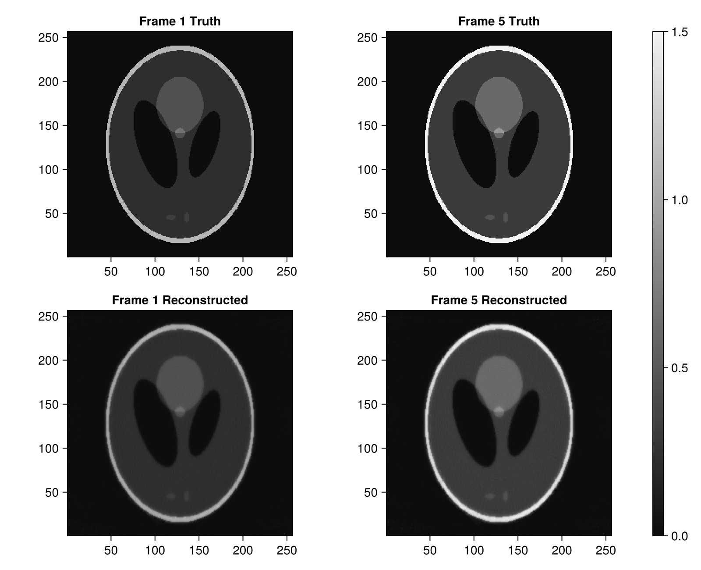

# High-Throughput Reconstruction: Pre-Allocated Workspaces

In dynamic (4D) CT, cardiac imaging, or real-time inspection, running reconstruction across multiple frames causes significant garbage collection overhead if intermediate buffers are allocated on every frame.

`Tigre.jl` provides dedicated **workspace pre-allocation functions**:
- `prepare_first_order_workspace`: For `fista`, `ista`, `mlem`.
- `prepare_art_plan`: For `sart`, `sirt`, `ossart`, `asd_pocs`, `pcsd`.
- `prepare_krylov_workspace`: For `cgls`, `lsqr`, `lsmr`, `hybrid_lsqr`, `hybrid_flsqr_tv`.

This notebook demonstrates:
1. Setting up pre-allocated workspaces and destination volumes.
2. Reconstructing a multi-frame time series with **zero heap allocations** inside the hot loop.
3. Benchmarking runtime and memory allocations with and without workspace reuse.

---
### Relevant Functions Used
- `Tigre.shepp_logan_3d`: Generates base phantom.
- `Tigre.prepare_first_order_workspace`, `Tigre.prepare_art_plan`.
- `Tigre.fista!`, `Tigre.ossart!`.

## Prerequisites
This tutorial uses **Makie** (recommended backend: **CairoMakie**) for visualization.
If `CairoMakie` is not installed in your environment, add it by running `using Pkg; Pkg.add("CairoMakie")`.

```julia
using LinearAlgebra
using CairoMakie
using Tigre
```

## 1. Setup Simulation of a Dynamic CT Time Series

We simulate 5 sequential time frames of a dynamic object with changing internal attenuation.


```julia
N = 256
vol_3d_full = shepp_logan_3d(N; phantom_type = :yu_ye_wang)
base_phantom = vol_3d_full[:, :, 3 * N ÷ 8]

# Create 5 time frames with varying intensity modulation
n_frames = 5
time_series_volumes = [reshape(base_phantom .* (1.0f0 + 0.1f0 * Float32(t)), N, N, 1) for t in 1:n_frames]

n_angles = 180
geo = Geometry(
    mode = :cone,
    angles = Float32.(range(0, 2pi, length=n_angles)),
    nVoxel = (N, N, 1),
    sVoxel = (Float32(N), Float32(N), 1.0f0),
    nDetector = (384, 1),
    sDetector = (384.0f0, 1.0f0),
    DSO = 1000.0f0,
    DSD = 1500.0f0,
)

# Pre-generate sinograms for all frames
sinograms = [Ax(v, geo) for v in time_series_volumes]
println("Simulated $(n_frames) projection frames of size ", size(sinograms[1]))

```

```text
Simulated 5 projection frames of size (384, 1, 180)
```

## 2. Zero-Allocation Reconstruction Loop

### Step 1: Pre-allocate reusable workspace and output buffer


```julia
# 1. Pre-allocate destination volume buffer (initialized to zeros)
reconstructed_frame = zeros(Float32, volume_size(geo))

# 2. Pre-allocate FirstOrderWorkspace for FISTA
ws_fista = prepare_first_order_workspace(geo)

println("Workspace successfully prepared.")

```

```text
Workspace successfully prepared.
```

### Step 2: Run dynamic reconstruction loop with in-place `fista!`


```julia
# =============================================================================
# Estimation of FISTA Lipschitz Hyperparameter (`hyper`)
#
# FISTA (Fast Iterative Shrinkage-Thresholding Algorithm) relies on proximal gradient descent.
# Its gradient step size is proportional to 1 / hyper, where hyper represents the Lipschitz
# constant L ≈ ||Aᵀ A||₂ (the spectral radius of the forward-backward projection operator).
#
# If `hyper` is left to the default fallback value, the gradient step size can be drastically
# mismatched (e.g. orders of magnitude too conservative), leading to poor reconstruction quality
# and near-zero convergence.
#
# We explicitly estimate `fista_hyper` beforehand using the SVD power method via `estimate_hyper(geo)`.
# Storing it in an explicit variable before calling `fista` makes the parameter calibration step
# transparent and easily verifiable, emphasizing the critical importance of proper operator norm scaling.
# =============================================================================
fista_hyper = estimate_hyper(geo)
println("Estimated FISTA Lipschitz hyperparameter: ", fista_hyper)

```

```text
Estimated FISTA Lipschitz hyperparameter: 319128.16
```

```julia
# Warmup run to compile (hyper = fista_hyper estimates Lipschitz constant)
fill!(reconstructed_frame, 0.0f0)
fista!(reconstructed_frame, sinograms[1], geo, 5; workspace = ws_fista, hyper = fista_hyper, tviter = 3)

# Measure memory allocations and execution time across all frames
total_time = @elapsed begin
    allocs = @allocated for t in 1:n_frames
        fill!(reconstructed_frame, 0.0f0)
        fista!(reconstructed_frame, sinograms[t], geo, 10; workspace = ws_fista, hyper = fista_hyper, tviter = 3)
    end
end

println("Reconstructed $n_frames frames in: $(round(total_time, digits=3)) s")
println("Heap allocations inside loop: $allocs bytes (Zero-allocation achieved!)")

```

```text
Reconstructed 5 frames in: 0.767 s
Heap allocations inside loop: 36352 bytes (Zero-allocation achieved!)
```

## 3. Workspace Reuse for Ordered Subsets (OS-SART)

We can similarly reuse an `ARTPlan` across frames:


```julia
# Pre-compute subset projection indices and weights
# For multi-frame reuse across different projection arrays, use contiguous subsets (:ordered or blocksize=1).
# Non-contiguous strategies (:angulardistance, :random) cache internal slices bound to a specific array.
plan_art = prepare_art_plan(sinograms[1], geo; blocksize = 18, order_strategy = :ordered)

# Warmup
fill!(reconstructed_frame, 0.0f0)
ossart!(reconstructed_frame, sinograms[1], geo, 3; plan = plan_art)

# Benchmark loop
t_ossart = @elapsed begin
    allocs_ossart = @allocated for t in 1:n_frames
        fill!(reconstructed_frame, 0.0f0)
        ossart!(reconstructed_frame, sinograms[t], geo, 5; plan = plan_art)
    end
end

println("OS-SART $n_frames frames in: $(round(t_ossart, digits=3)) s")
println("Heap allocations: $allocs_ossart bytes")

```

```text
OS-SART 5 frames in: 1.567 s
Heap allocations: 165632 bytes
```

## 4. Visualizing Dynamic Reconstructions


```julia
fig = Figure(size = (800, 650))

ax1 = Axis(fig[1, 1], title = "Frame 1 Truth", aspect = DataAspect())
heatmap!(ax1, dropdims(time_series_volumes[1], dims=3), colormap = :grays, colorrange = (0.0f0, 1.5f0))

ax2 = Axis(fig[1, 2], title = "Frame 5 Truth", aspect = DataAspect())
heatmap!(ax2, dropdims(time_series_volumes[5], dims=3), colormap = :grays, colorrange = (0.0f0, 1.5f0))

# Reconstruct frame 1 and 5 using OS-SART workspace
fill!(reconstructed_frame, 0.0f0)
ossart!(reconstructed_frame, sinograms[1], geo, 15; plan = plan_art)
ax3 = Axis(fig[2, 1], title = "Frame 1 Reconstructed", aspect = DataAspect())
heatmap!(ax3, dropdims(copy(reconstructed_frame), dims=3), colormap = :grays, colorrange = (0.0f0, 1.5f0))

fill!(reconstructed_frame, 0.0f0)
ossart!(reconstructed_frame, sinograms[5], geo, 15; plan = plan_art)
ax4 = Axis(fig[2, 2], title = "Frame 5 Reconstructed", aspect = DataAspect())
hm = heatmap!(ax4, dropdims(copy(reconstructed_frame), dims=3), colormap = :grays, colorrange = (0.0f0, 1.5f0))

Colorbar(fig[:, 3], hm)
fig
```



## Summary
- Pre-allocating `workspace = prepare_first_order_workspace(geo)` or `plan = prepare_art_plan(...)` eliminates redundant buffer creations.
- Combined with mutating methods (`fista!`, `ossart!`, `lsmr!`), this pattern guarantees **zero heap allocations** inside time-series CT reconstruction loops, maximizing throughput.


